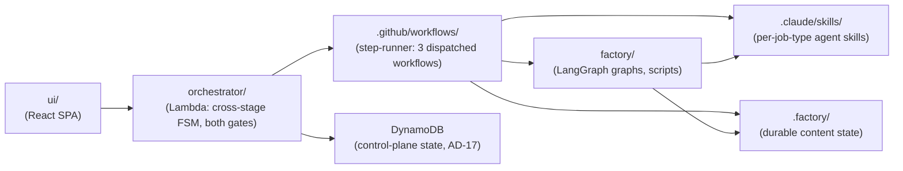

# Architecture Spine — light-factory

## Design Paradigm

Two state-machine shapes coexist by design and are never unified. An external serverless orchestrator — a stateless AWS Lambda (AD-17) — owns the pipeline-level finite state machine and both human-wait gates (`plan-approval`, `evidence-approval`). Its own cross-stage state machine is hand-rolled plain Lambda/DynamoDB application code (a stage field plus explicit transition logic), deliberately NOT a LangGraph graph: this keeps LangGraph scoped exactly as AD-6 already fixes it — judgment work only, within a single job's own runner process — rather than stretching it across this new serverless/webhook boundary. GitHub Actions is demoted to a step-runner: the orchestrator invokes each stage independently via `workflow_dispatch`, and the pipeline splits into three separate workflow files at the two gate boundaries (split only at the gate seams, not full atomization): one workflow for analysis (ends at Gate 1), one for implementation→checks→review (ends at Gate 2, still internally chained via `needs:` exactly as today), and one for merge. LangGraph's scope is UNCHANGED by this update — it continues to own in-job judgment-work orchestration only (analysis, implementation, review, the fix loop), living and dying within a single job's own runner process; graph state never needs to survive a job boundary, and AD-6 is not touched, only cross-referenced here. What crosses a job boundary is still durable content state only (the files under `.factory/`, committed to the run's branch, AD-10); what crosses a *stage* boundary (a `workflow_dispatch`) is the orchestrator's own control-plane state (DynamoDB, AD-17) plus whatever inputs that dispatch needs (AD-8).

Namespace mapping:
- `.github/workflows/` — the step-runner: three workflow files (analysis; implementation→checks→review; merge), each invoked independently via `workflow_dispatch` by the orchestrator.
- `factory/` — the portable orchestration layer: LangGraph graphs and scripts, agnostic of any specific CI platform (unchanged).
- `.claude/skills/` — per-job-type agent capabilities (analysis, implementation, review), invoked by `factory/` (unchanged).
- `.factory/` — durable content state that crosses job boundaries, read by both the human reviewer and the orchestration script (unchanged, AD-10).
- `orchestrator/` — the Lambda's own application code: webhook handling, the hand-rolled cross-stage FSM, fine-grained-PAT GitHub auth, DynamoDB control-plane reads/writes (AD-17, AD-18).
- `infra/` — Terraform IaC for the AWS resources (Lambda, DynamoDB, Secrets Manager, S3) and the repo-level webhook config (AD-22).
- `ui/` — the React SPA: developer dashboard, GitHub-OAuth login (AD-23), PR-comment actions posted via the orchestrator on the developer's behalf (AD-21).

## Invariants & Rules



Dependency arrows point from the orchestrator toward GitHub Actions, from the UI toward the orchestrator, and from GitHub-Actions-specific wiring inward — never the reverse. `factory/` and `.claude/skills/` must never reference `.github/workflows/`-specific constructs (job/workflow names); `orchestrator/`, `infra/`, and `ui/` must likewise stay isolated from GitHub-Actions-specific wiring. This is what keeps the orchestration layer, and now the orchestrator itself, portable.

### AD-1 — Blueprint/template repo shape

- **Binds:** all
- **Prevents:** factory logic becoming entangled with any one target repo's CI specifics, blocking a later migration to a dedicated cross-repo orchestrator
- **Rule:** software-factory ships as a template copied into each target project's own repo, not as a dedicated orchestrating repo. The orchestration graph, agent skill configs, and pipeline scripts (`factory/`, `.claude/skills/`) must stay isolated from GitHub-Actions-specific wiring (`.github/workflows/`) so they can migrate to a dedicated orchestrator later without a rewrite. The same isolation now applies to the orchestrator's own code and infrastructure (`orchestrator/`, `infra/`, `ui/`) — none of them may reference GitHub-Actions-specific constructs either, consistent with the Design Paradigm's namespace mapping.

### AD-2 — Gates owned by the orchestrator, not GitHub Actions; LangGraph's in-job scope unchanged

- **Binds:** pipeline orchestration, all stages; the `plan-approval` gate; the `evidence-approval` gate
- **Prevents:** forcing in-job agent state to survive across separate ephemeral runner instances (LangGraph's scope stays in-job only, AD-6); conflating the human-initiated Gate-1 `/rework` loop with AD-13's own pre-gate agent clarification loop (different trigger, different actor — see AD-13); an ordinary job/stage failure being mistaken for a reject
- **Rule:** the two human-wait gates (canonical identifiers unchanged: `plan-approval`, `evidence-approval`) are owned by the external orchestrator (AD-17), not by a GitHub Environment or native branch protection. Gate 1 (`plan-approval`) is judged the more critical of the two gates — it reviews the plan before any implementation effort is spent on it — and, reflecting that, carries the richer command grammar below. Both gates now use the SAME mechanism: an orchestrator-owned PR-comment command grammar, read off the one GitHub webhook event the App subscribes to (`issue_comment`, AD-18). `plan-approval`: `/approve` triggers a `workflow_dispatch` of the implementation→checks→review workflow; `/rework <feedback text>` loops back to re-invoke the analysis stage — before re-dispatching, the orchestrator appends the feedback text to the triggering story `.md` file itself as a new commit on the branch, rather than passing it as a separate dispatch input, so the re-invoked analysis stage still reads only the story file as its input and AD-13's "the story file is the only input `run_analysis` ever reads" invariant stays literally true rather than being widened or given a second input path; this loop is distinct from AD-13's own pre-gate clarification loop (see AD-13's note); `/reject` cancels the story, closing the PR directly (superseding AD-16's trailing reject-cleanup job — see AD-16) — terminal for this run, same as below. `evidence-approval`: `/approve` triggers the new bounded agent-conflict-resolution loop (AD-19) followed by the existing deterministic merge step (AD-14, unchanged); there is no `/rework`-equivalent action at this gate — no "re-plan" step applies once implementation is already built and reviewed — so a problem found here is raised via `/reject` instead; `/reject` cancels the run exactly as at Gate 1: the PR closes with a comment stating why, this run is terminal, and the developer re-triggers as a new run (AD-15) rather than resuming the same one. GitHub Actions itself is demoted to a step-runner: each stage is invoked independently via `workflow_dispatch` (see Design Paradigm), no longer paused/resumed natively by GitHub. LangGraph's scope is unaffected — it continues to own in-job judgment orchestration only, within a single job's runner process (AD-6).
- **Superseded 2026-11-03** (`brainstorm-quality-gate-alternatives`): the original Rule gave both gates to native GitHub Actions Environment + required-reviewers protection rules, pausing/resuming the same workflow run natively for up to 30 days with no extra infrastructure, with a reviewer reject terminal for that run (no same-run resume-into-an-earlier-job). That mechanism is restricted to GitHub Enterprise or public repos; this repo is private and non-Enterprise, so it was never actually usable here — hence the orchestrator-based replacement above, rather than a mere extension of the old one.
- **Superseded 2026-11-03 (second revision, same session)** (`brainstorm-quality-gate-alternatives`): between the Environment-based original and the Rule above, `evidence-approval` passed through an intermediate design — a plain native GitHub branch-protection "require PR approval" rule, chosen at that point for being free on any GitHub plan tier with no custom infra, with the orchestrator merely notified via the PR-review-submitted webhook. That precondition doesn't hold: branch protection on a *private* repo requires GitHub Team tier or above and does not work at all on GitHub Free (confirmed 2026-11-03, `reviews/review-versions.md`) — unacceptable since software-factory ships as a blueprint copied into arbitrary target repos on whatever plan their owner holds (AD-1), not a fixed one this spine can assume. `evidence-approval` therefore moved onto the same PR-comment command grammar as `plan-approval` instead (the Rule above), so both gates work identically regardless of the target repo's GitHub plan. The "free on any plan, no custom infra" framing is preserved here only as historical context for why branch protection was tried first, not as current rationale — current rationale is plan-tier independence, stated above.

### AD-3 — No hosted orchestration server for v1

- **Binds:** orchestration technology choice
- **Prevents:** introducing a separately hosted stateful orchestration server that contradicts the blueprint/minimal-footprint PoC goal
- **Rule:** v1 must not depend on a hosted orchestration server (Camunda/Zeebe, Temporal). These are deferred as a possible future upgrade only if software-factory becomes a dedicated repo orchestrating many target projects at scale.
- **Note (2026-11-03):** remains intact and unaffected by this update — Lambda is serverless/event-driven, not the stateful Temporal/Camunda-style hosted server this AD gatekeeps against.

### AD-4 — Gate summaries as PR comments, detail in committed files

- **Binds:** the `plan-approval` gate, the `evidence-approval` gate
- **Prevents:** forcing the human reviewer to open full detail files just to make a go/no-go decision
- **Rule:** every stage ending in a human gate posts a concise human-readable summary as a PR comment, while the full detail stays in the committed `.factory/` state file for drill-down. The human decides from the summary and opens full detail only when warranted. Since AD-12 opens the PR during intake, both `plan-approval` and `evidence-approval` use the same PR-comment mechanism uniformly — there is no commit-comment special case.
- **Addendum (2026-11-03):** for both gates, the same PR-comment mechanism this AD already establishes for gate *summaries* is now also the approval mechanism itself (AD-2) — the comment the human posts back is both how they see the summary's context and how they act on it. `evidence-approval` keeps posting its evidence summary as a PR comment exactly as before; it is no longer additionally gated by a native GitHub PR review — that intermediate mechanism is itself superseded (AD-2's second "Superseded" note) — so the comment thread is the sole mechanism for both gates now, not a summary-plus-separate-review split.

### AD-5 — Defense-in-depth least-privilege enforcement

- **Binds:** all agent invocations
- **Prevents:** relying on a single permission layer that a misbehaving or prompt-injected agent could bypass
- **Rule:** least privilege is enforced at two independent layers, neither sufficient alone: (1) a Claude Code tool-allowlist per invocation — e.g. the review agent has no write/edit tool at all; the implementation agent's edit tools are scoped both to its isolated branch (git-ref boundary) **and** to the state-file paths AD-10 assigns to its own stage, explicitly excluding `plan.md`, `decisions.md`, and `review.md` (owned by other stages) even though those files live on the same branch; no invocation has merge/admin tools. (2) platform-level GitHub token/branch-protection scoping — each job's token permissions match only that stage's needs, and branch protection blocks direct push to main and requires PR + checks to merge, independent of what any agent attempts. The `analysis` job's token permissions include `contents: write` and `pull-requests: write` to run AD-12's branch/PR-open script — scoped to that script alone, never to the analysis agent's own tool-allowlist, which stays read-only. The `implementation` and `checks` jobs hold `contents: write` only (branch checkout, commit, push); `review` adds `pull-requests: write` for the `evidence-approval` summary comment; `merge` holds both for the squash-merge.
- **Addendum (2026-11-03):** the new bounded merge-conflict-resolution agent (AD-19) follows this AD's layer-(1) *philosophy* — a Claude Code tool-allowlist scoped to the branch, no `main` access, no merge/admin tool — but NOT its literal path-allowlist: see AD-19's own Rule for the precise difference (branch-scoped, any path in the diff, not restricted to the implementation agent's own subtask-file list).

### AD-6 — Orchestration language: Python / LangGraph native SDK; scope is judgment work only

- **Binds:** orchestration layer (`factory/graph/`); the boundary between the graph and direct pipeline steps
- **Prevents:** splitting orchestration logic across languages or SDKs; wiring deterministic checks as LangGraph nodes or agent tool calls, which would silently move them from direct pipeline steps back into agent-delegated work
- **Rule:** the orchestration graph is implemented in Python using LangGraph's native SDK, and its scope is judgment work only — analysis, implementation, review, and the fix loop. Deterministic checks (build, test, lint, security) are implemented as direct pipeline steps in `.github/workflows/`, never as graph nodes or agent tool calls.
- **Addendum (2026-10-11, `epic-pipeline-hardening` ticket 1):** the commands those four steps run are not written in `run_checks.py`; they come from the repo's own `.github/post-implementation-checks.yml` (YAML, parsed with PyYAML), so one script checks whatever project the repo holds. The check names stay fixed (`build`, `test`, `lint`, `security`). Each check holds a list of commands, each a list of arguments with no shell; all of them run on every story, in order, with no path filtering, and the check stops at the first failure. A check with no command records `status: "skipped"`, never `"pass"` — in the software-factory repo that is `security`, permanently (user's call); a project that wants a real security check configures a command for it. A missing or malformed config is a `"fail"` naming the problem, never a silent skip. The config is read from `origin/main` (`git show`), not from the story branch's working tree, so a story cannot change the commands by editing the config (`run_checks.py` itself still runs from the story branch); only if that ref cannot be read does it fall back to the working tree, and each evidence file records which one was used as `config_source`. Runner toolchain setup (e.g. a JDK or Node) is not part of the config; it is a workflow step added with the project that needs it.
- **Addendum (2026-10-12, `epic-demo-app` ticket 7):** when a project's own checks need a runner toolchain the `ubuntu-latest` runner doesn't already provide (freight-tenders needs Java 25 and Node 26, neither implicit), that setup is still a workflow step, not folded into the config above as new logic — but which versions to install is itself config-driven, the same way the commands are. `.github/post-implementation-checks.yml` gains a second, optional top-level mapping, `toolchains:` (keys limited to `java`/`node` — only what this project needs; a project needing more extends the mapping and the reader together, not by inventing a parallel mechanism), read by a new `run_checks.py toolchains` subcommand via the same `origin/main`-with-working-tree-fallback path the four checks already use, printing `java=`/`node=` lines (empty string for an absent key) shaped for `>> "$GITHUB_OUTPUT"`, mirroring `state_io.py`'s `derive`. The `checks` job's workflow gains three steps before its check steps: run that subcommand into `$GITHUB_OUTPUT` (`id: toolchain`), then `actions/setup-java@v6` and `actions/setup-node@v7`, each `if:`-gated on that step's own output being non-empty — so a repo/config with no `toolchains:` entry runs exactly as before this addendum, with no setup step and no behavior change.
- **Addendum (2026-10-12, ticket 2):** the fixed check names gain a fifth, `static_analysis` — a category for bug-pattern static analysis, distinct from the style-only `lint` check, that the generic pipeline mechanism had no name for. It mirrors the other four exactly: a `run_static_analysis()` wrapper in `run_checks.py`, a 5th `checks` job step, and a 5th entry in the "fail job if any check failed" loop. In the software-factory repo it is left unconfigured — `static_analysis:` names the key in `.github/post-implementation-checks.yml` with no commands, so it records `status: "skipped"`, never `"pass"`, the same way `security` does today (user's call, 2026-10-12). Real commands for freight-tenders are deferred to a separate plan. **Follow-up (2026-10-12, ticket 2's freight-tenders plan):** that separate plan has now landed — `static_analysis:` holds real commands for freight-tenders, `mvn spotbugs:check` for the backend and a new dedicated ESLint bug-pattern script for the frontend, so it records `"pass"`/`"fail"` for freight-tenders rather than `"skipped"`.
- **Addendum (2026-10-13, backlog bug 5):** a check must not rely on an earlier check having run. The `checks-fix-loop` job re-runs only the failed check(s) on a fresh runner, so a dependency install that lived in `build`'s command list (`npm ci`) was missing from every re-check of `test`, `lint` or `static_analysis`, which then failed with return code 127 on correct code (runs 38377603346, 38387681388). Two things now hold for both jobs. (1) The toolchain setup above is one local composite action, `.github/actions/checks-toolchain`, used by the `checks` job and the `checks-fix-loop` job alike — neither carries setup steps of its own, and `factory/scripts/tests/test_workflow_checks_setup.py` fails if that changes. (2) `.github/post-implementation-checks.yml` gains a third, optional top-level key, `setup:` — a list of commands shaped like a check's, read the same `origin/main`-first way — holding what prepares the checkout for the checks (`npm ci` moved there from `build`). `run_checks.py setup` runs it as a `checks` job step before the five checks (`continue-on-error`, so they still run and leave evidence; a failed setup then fails the job); `checks_fix_loop_graph.py` calls the same `run_checks.run_setup()` as a plain function before every re-check, after the agent's edits, since a fix may change what there is to install — and so does the `review` job's `fix_loop_graph.py` before its own `build`/`test` recheck (AD-11), which runs on a fresh runner too and had relied on `build` installing the dependencies. Setup is not a sixth check, but its result is recorded the way a check's is, as `evidence/checks/setup.json`, so a setup that failed in the `checks` job can be named by the job that follows. A config without `setup:` prepares nothing and behaves as before. Not covered here: the `review` job still installs Node 22 itself and does not use the shared toolchain action (tracked in `deferred-work.md`).

### AD-7 — External dependencies scoped to GitHub + Claude Code + the AWS orchestrator stack

- **Binds:** all
- **Prevents:** scope creep into ticket-system or chat integrations before v1 proves the core loop
- **Rule:** v1's external dependencies are GitHub (repo, Actions, a fine-grained repo-scoped PAT — AD-18, plus a separate GitHub OAuth App for UI login — AD-23, unaffected by AD-18's PAT change since a GitHub OAuth App is a distinct GitHub product from a GitHub App), Anthropic/Claude Code, and now AWS — specifically Lambda, the Lambda Function URL, and DynamoDB (AD-17) — named explicitly to preserve this AD's original anti-scope-creep intent rather than opening it unboundedly. No ticket system or chat integration is in scope. Terraform is a deploy-time/IaC tool, not a runtime external dependency the pipeline integrates with, and is tracked under Stack/Structural Seed instead (AD-22).

### AD-8 — Per-story, per-run state directory layout, slug derivation, and propagation

- **Binds:** state persistence across all stages
- **Prevents:** concurrent stories colliding on shared state files; two jobs/workflows independently computing different story-slugs and reading/writing different directories; a re-triggered run of the same story colliding with its terminal predecessor's state (see AD-15)
- **Rule:** state lives at `.factory/<story-slug>/<run-id>/` per story per run (AD-15 defines `run-id`), holding `plan.md`, `decisions.md`, `review.md`, and `evidence/{checks/, review/}` (split by writer: `checks/` for deterministic pipeline-step output — build/test/lint/security; `review/` for the independent review agent's findings/metrics). `story-slug` is derived from the triggering story file's name (`stories/<project>/<story-slug>.md`, `<project>` being `software-factory` or `freight-tenders`, kebab-case required on the input file; the slug is the file name alone and carries no project — AD-15 keeps it unique). `story-slug` and `run-id` are no longer derived once in GitHub's first job and threaded via `needs:` outputs as the sole propagation mechanism: the orchestrator (AD-17) now derives and owns both, passing them as `workflow_dispatch` inputs to whichever of the three dispatched workflows (analysis; implementation→checks→review; merge) is firing. Inside the implementation→checks→review workflow, which still internally chains its jobs via `needs:` exactly as before, propagation between those internal jobs is unchanged — its first job still exposes the slug/run-id (now received as `workflow_dispatch` inputs rather than self-derived) as its own job output for the jobs that follow it in that same workflow.

### AD-9 — Claude Code auth via subscription OAuth token

- **Binds:** all Claude Code invocations
- **Prevents:** metered pay-per-token billing exposure from agent calls, including retries within the bounded fix loop
- **Rule:** authenticate with `CLAUDE_CODE_OAUTH_TOKEN` (subscription-based: Pro/Max/Team/Enterprise), not `ANTHROPIC_API_KEY`. The token must be generated via `claude setup-token` — the long-lived, CI-intended path. The quick `/install-github-app` setup flow's OAuth token is explicitly out: it is reported to expire in hours-to-a-day with no auto-refresh, which would silently break a pipeline mid-gate-wait and undermine this AD's own reliability intent. Billing draws from the subscription's shared usage budget; the bounded-fix-loop cost guardrail (AD-11) applies against that same budget.

### AD-10 — Append-only per-stage state file ownership

- **Binds:** all pipeline stage state files under `.factory/<story-slug>/`
- **Prevents:** one stage overwriting or corrupting another stage's record, which would break the audit trail; divergence between human-readable and machine-readable state
- **Rule:** each stage writes only its own state file (e.g. the analysis stage writes `plan.md` and `decisions.md`; the review stage writes `review.md`) and never mutates a prior stage's file. Every state file's YAML frontmatter uses exactly these shared field names — no stage invents its own naming for the same concept: `schema_version` (int), `story_slug` (string, matches the directory name from AD-8), `stage` (`analysis` \| `implementation` \| `review`), `status` (stage-specific enum below), `updated` (ISO 8601). Canonical `status` values: `plan.md`/`decisions.md` — `drafted`, `awaiting-clarification`, `clarification-cap-reached`, `ready-for-review`; `review.md` — `in-review`, `findings-open`, `fix-in-progress`, `resolved`, `unresolved-after-cap`. No other status strings are valid. Both the human reviewer and the orchestration script read this frontmatter as the single source of truth. **Addendum 2026-10-11** (entry 8 of `epic-pipeline-open-issues`, which moved the mechanical checks and the review into their own jobs): state crosses job boundaries only through git. The `checks` and `review` jobs each start by checking out the run's branch (`checkout_branch.py`) and end by committing and pushing whatever they wrote under `.factory/` (`commit_push_implementation.py --label Checks` / `--label Review`) — unconditionally, so `evidence/checks/` and `review.md`/`evidence/review/` reach the next job even when no fix cycle committed anything. There is no second persistence mechanism (e.g. workflow artifacts). **Addendum 2026-10-13** (gap found reviewing run 38375222879): the `checks` job's five check steps (`build`/`test`/`lint`/`security`/`static_analysis`) each carry `continue-on-error: true` so all five run and commit their evidence regardless of an earlier failure, and the job then says whether one failed via a job output (`run_checks.py any-check-failed`), mirroring `analysis`'s `status` output, rather than by failing the job outright — see the full mechanism recorded here prior to this update. **Addendum (2026-10-13, backlog bug 5):** `checks.md` is the state file of stage `checks` (`state_io.py`'s `STATUS_BY_STAGE`), a stage that spans two jobs; see the full mechanism recorded here prior to this update for `checking`/`findings-open`/`fix-in-progress`/`resolved`/`unresolved-after-cap`/`tooling-failure` and the `reconcile` path.
- **Addendum (2026-11-03):** the new DynamoDB table (AD-17) holds ONLY orchestrator control-plane state — current stage/status, branch name, retry/cycle counters — and is never a second copy of `plan.md`/`decisions.md`/`review.md`/`evidence/` content. Those remain the system of record, written only via git, exactly as this AD already requires.

### AD-11 — Bounded fix loop, hard cap at 2 cycles

- **Binds:** the `review` job's review → fix → re-check loop
- **Prevents:** open-ended agent spend on a story the automated review keeps rejecting; silently burning AI budget instead of surfacing the problem to a human
- **Rule:** `review.md`'s frontmatter tracks a fix-cycle counter, incremented only by the orchestration graph's own loop-control node — never by the review agent's or the fix agent's output. Agents report findings and fixes; only the graph mutates the counter. The graph enforces a hard cap of 2 fix cycles: on the second unresolved review, it must not loop again — it routes directly to the `evidence-approval` gate with `status: unresolved-after-cap`, carrying the outstanding findings for the human to triage, rather than continuing to spend agent turns. Each cycle re-runs only the checks relevant to the finding(s) being fixed, not the full check suite.
- **Note (2026-11-03):** the new merge-conflict-resolution loop (AD-19) follows this AD's and AD-13's established bounded-loop pattern — hard cap of 2, counter owned solely by orchestration logic, never by the agent.

### AD-12 — PR opened by a deterministic pipeline step, once intake decides to proceed

- **Binds:** the `analysis` job, post-CAP-1 sequencing; branch reuse by the `implementation`, `checks` and `review` jobs; ties to AD-4, AD-5, AD-8, and AD-13
- **Prevents:** ambiguity about when/how the PR backing the rest of the run comes into existence; an analysis or implementation agent holding an unscoped git-push/PR-create capability AD-5's tool-allowlist model never named; a dangling open PR surviving a below-cap clarification halt or a gate reject with no closing action (see AD-2, AD-13, AD-15)
- **Rule:** once the `analysis` job's CAP-1 intake judgment decides to proceed (not on a halt), a deterministic pipeline script — not the agent — creates the isolated branch named from AD-8's story-slug and AD-15's run-id (`software-factory/<story-slug>/<run-id>`), commits the analysis stage's own first write of `plan.md`/`decisions.md` as the branch's first real commit (no placeholder commit needed — this is genuine content, not a GitHub-API workaround), and opens the PR against the target branch. This PR is the single artifact for the rest of the run: `plan.md`/`decisions.md` updates across clarification rounds (AD-13), the `plan-approval` gate summary (AD-4), all automated-check output, review findings, and fix-loop commits, and the `evidence-approval` gate summary all land on it. The `implementation`, `checks` and `review` jobs reuse this same branch — each checks it out via the propagated branch name (AD-8/AD-15 outputs), none creates a new one. Because this is a script step under AD-5's per-job token scoping (not the agent's own tool-allowlist), neither the analysis agent nor the implementation agent ever receives a branch-create or PR-create tool. A run that halts at CAP-1 (incomplete/out-of-scope) never reaches this script — no branch or PR exists for it. The same script closes any prior open PR for this story-slug it supersedes (AD-15) — branches and state directories are never deleted, only the superseded PR closes.
- **Note (2026-11-03):** the branch name this script creates now also doubles as the `workflow_dispatch` correlation key the orchestrator uses (AD-20) to match a later stage-completion webhook back to the correct story/run, since `workflow_dispatch` itself returns no run id.

### AD-13 — Clarification: bounded rounds via re-trigger, no live mid-job wait (cap 2, counted from the PR chain)

- **Binds:** the `analysis` job's LangGraph graph (intake, analysis)
- **Prevents:** ambiguity about what happens when analysis can't fully resolve the story alone — without this, intake would either guess (undermining CAP-1/CAP-2) or silently stall; unbounded repetition of the same halt-and-re-trigger cycle with no signal that the story itself, not just a missing answer, may be the problem
- **Rule:** The `analysis` job makes one analysis invocation per run. If it returns any `open_questions`, the graph halts intake for that run — writes `plan.md`/`decisions.md` with `status: awaiting-clarification` (below cap) or `status: clarification-cap-reached` (at cap, AD-10's enum, new value), tags the PR AD-12 opened at intake with a `clarification-round` label so this round counts toward the cap, posts the open question(s) (or the cap-reached notice) as a comment on it, and — below the cap only — closes it per AD-15; at the cap the PR is left open for the developer to decide how to proceed (this path ends the run without reaching a gate, so AD-4's Rule doesn't itself cover the comment step — the convention is shared, the authority is this AD). The run ends without a gate mechanically: the `analysis` job exposes its status as a job output, and the `implementation` job — the one `plan-approval` guards — runs only when that status is `ready-for-review`, so on a halt it and every job after it are skipped and no review is requested. A failure to write that status output fails the `analysis` job with its own exit code (5), so the gate stays closed. Before the state files are written, a deterministic step (never the agent) counts this story-slug's prior PRs in **any state** (open or closed) carrying the `clarification-round` label — a completed clarification round only (closed below cap, left open at cap), distinct from a reject-closed or ordinary-supersession-closed PR. If that prior count is already at or above the hard cap of 2 (matching AD-11's), this round's status and comment are `clarification-cap-reached` regardless of which attempt number it technically is. Below the cap, the developer answers by editing the story file itself (the only input `run_analysis` ever reads) and re-triggers the pipeline as a new run, consistent with AD-2's reject-is-terminal/re-trigger pattern and v1's manual-trigger-only model. No live mid-job wait is introduced — AD-2's two-gate model (`plan-approval`, `evidence-approval`) is unchanged by this AD. **Decided 2026-10-10** (see `change-clarification-loop-bounded-rounds/change-clarification-loop-bounded-rounds.md`); this supersedes the v1 single-pass-halt simplification of 2026-10-02.
- **Note (2026-11-03):** distinct from the new Gate-1 `/rework (feedback text)` command (AD-2): this AD's clarification loop is the analysis agent's OWN self-raised open-questions halt, occurring BEFORE a plan ever reaches Gate 1 for human review. `/rework` is a human-initiated rework of a plan AFTER it has been posted for review — a different trigger, different actor, same general "loop back to analysis" shape, but a separate mechanism with its own cap, not to be conflated with this one.

### AD-14 — Merge is a deterministic pipeline step, never an agent action

- **Binds:** the `merge` job
- **Prevents:** the `merge` job existing with no Rule behind it at all — AD-5 already rules out an agent performing the merge, but nothing previously said what does
- **Rule:** the `merge` job executes the merge as a direct pipeline step, triggered automatically on `evidence-approval`'s approval — consistent with AD-5's "no agent invocation ever holds merge/admin tools" and the v1 goal of a green, trusted pipeline that completes without a manual UI click. Merge strategy (squash/merge-commit/rebase) and source-branch deletion are not decided here — see Deferred.
- **Note (2026-11-03):** now runs as the last of three `needs:`-chained jobs inside `merge.yml` itself — after `detect-conflict` and, where a conflict existed, `resolve-conflict` (AD-19) has ensured the branch is conflict-free — still a deterministic step, still never an agent.

### AD-15 — Run-level isolation on re-trigger: concurrency-guarded, versioned by run-id, superseded PRs linked and closed

- **Binds:** AD-8's state-directory layout, AD-12's branch/PR naming, the overlapping-run concurrency guard; the re-trigger path from AD-2's reject-is-terminal pattern and AD-13's cap-out
- **Prevents:** a re-triggered run colliding with its terminal predecessor's branch/PR/state-directory (all previously keyed only by story-slug, which doesn't distinguish attempts); a prior attempt's analysis/review/evidence being silently overwritten or orphaned; two runs for the same story racing concurrently, where a reviewer could approve a gate on a run a later re-trigger has already superseded — a "zombie" approval reaching the `merge` job against an already-closed PR
- **Rule:** `derive_story_slug` requires the triggering story path to be exactly `stories/<project>/<name>.md` relative to the repository root, `<project>` being `software-factory` or `freight-tenders`, which rules out `stories/foo.md`, `other/foo.md`, `docs/stories/software-factory/foo.md`, `stories/billing/foo.md`, `stories/software-factory/sub/foo.md` and paths outside the repo. The slug is the file name alone, so it also refuses a file name that exists in both project folders at dispatch time — two such files would otherwise share one state directory, branch prefix and PR chain. A second trigger for a story that still has a run in flight, including one paused at a gate, supersedes that run outright rather than racing it; a re-trigger is always treated as explicit intent to supersede, never queued behind a pending gate. Every run also computes a `run-id` (`run-<github.run_id>` — GitHub's own globally-unique run identifier, from the analysis stage's own dispatched run; zero extra bookkeeping) alongside the story-slug. AD-8's state directory and AD-12's branch/PR both nest under it: `.factory/<story-slug>/<run-id>/` and branch `software-factory/<story-slug>/<run-id>`. When AD-12's pipeline script opens a new run's PR, it searches for any other open PR for the same story-slug (by branch-name prefix `software-factory/<story-slug>/`) — this also catches a predecessor cancelled before it could close its own superseded PR, so cascading cancellations resolve without special-casing — closes each with a comment linking to the new PR ("superseded by #N"), and the new PR's own opening comment links back ("retry of #M"). Superseded branches and state directories are left in place, not deleted — only the PR closes — consistent with the audit-trail-over-cleanup posture AD-10 and AD-12 already set. AD-2's reject at either gate and AD-13's below-cap clarification halt each close their own run's PR at that moment too — with a comment stating why — not only when a later retrigger supersedes it. AD-13's own counting mechanism (how many prior rounds a story-slug has spent) is a separate query over PRs in **any state** (open or closed) by the same branch-name prefix, filtered to the `clarification-round` label — distinct from this Rule's open-PR search, which only ever finds the single currently-open PR to supersede. An open PR therefore almost always means "still awaiting a decision, never already resolved one way or the other" — except the one deliberate carve-out AD-13 creates: an at-cap PR stays open (so the developer can still act on it) but is itself a resolved, terminal state for that run, not an in-flight decision. There is no separate "current run" pointer file: the concurrency guard keeps at most one run in flight, and supersession-closing keeps at most one PR open per story-slug, so "which run is current" is always answered directly by GitHub — the one open PR matching the branch prefix (or, in the brief pre-PR window of the `analysis` job, whichever run is actually in flight).
- **Changed 2026-11-03** (`brainstorm-quality-gate-alternatives`, orchestrator split): the GitHub Actions workflow-level `concurrency:` block this Rule previously relied on assumed one single chained workflow run; it no longer applies once stages are independently `workflow_dispatch`ed into three separate workflow files (Design Paradigm). That protection now lives in the orchestrator itself: idempotent-state-check-on-entry on every Lambda invocation (checking the PR's and/or its DynamoDB row's actual current state rather than trusting the triggering event alone, AD-20) plus the branch-name correlation key (AD-20) — together these now prevent two overlapping in-flight runs for the same story, carrying this AD's concurrency-safety intent forward. The PR-supersession-closing behavior described above (search by branch-name prefix, close with a "superseded by #N" comment, link back) is UNCHANGED — still the same deterministic script, now running inside whichever workflow performs the analysis stage.
- **Addendum (2026-11-03):** this script (`open_implementation_pr.py`'s supersession-close path) is itself a second, independent writer of "is this PR closed" alongside the orchestrator's own `/reject`-webhook handler (AD-2) — and it runs inside a dispatched GitHub Actions job, not a Lambda invocation, so AD-20's "every Lambda invocation checks actual current state first" guard does not by itself cover it. Before closing or superseding a PR, this script now also reads the orchestrator's DynamoDB control-plane row (AD-17) for this story-slug as the authoritative current-state source, rather than deciding from GitHub PR state alone — extending AD-20's idempotent-check-before-acting pattern to this non-Lambda caller too, so a `/reject` landing at the Lambda and a supersession-close landing at this script cannot race to two contradictory PR-closing comments on the same PR.

### AD-16 — Reject detection from the run's review history, PR closed by a trailing job (Superseded 2026-11-03)

- **Binds (historical):** the workflow's job graph (a trailing job after `merge`); AD-2's reject-is-terminal rule; AD-15's "a reject closes its own run's PR at that moment"; AD-5's per-job token scopes
- **Prevents (historical):** a rejected run's PR staying open until someone closes it by hand; treating an ordinary job failure (a crash, a failing check, a merge conflict) as a reject and closing a PR that is still awaiting a fix — a rejected gated job ran no step and its `needs.<job>.result` read `failure`, exactly like a crash, so the result alone could not tell the two apart
- **Rule — Superseded 2026-11-03** (`brainstorm-quality-gate-alternatives`): with GitHub Environments removed (AD-2), there is no more "gated job result vs. a real reject" ambiguity to resolve via the Actions-approvals-API polling trick this AD existed for — a `/reject` PR comment is now read directly off the GitHub webhook by the orchestrator (AD-2, AD-17) and acted on immediately: no trailing job, no polling, no review-history lookup.
- **Original Rule (preserved for history):** the workflow ended with a reject-cleanup job that `needs:` `analysis`, `implementation` and `merge` and ran only when the run was not cancelled and one of the two gated jobs — `implementation` or `merge` — had result `failure`. It ran one deterministic script (`close_rejected_pr.py`), never an agent, deciding a reject only from the run's own review history (`GET /repos/{owner}/{repo}/actions/runs/{run_id}/approvals`) — never inferred from `needs.<job>.result` alone — and closed this run's PR with a comment naming the gate, the rejecting reviewer, and their review comment when they left one.

### AD-17 — Orchestrator component: stateless Lambda, Lambda Function URL, DynamoDB control-plane, hand-rolled FSM

- **Binds:** the pipeline-level state machine; both human-wait gates (`plan-approval`, `evidence-approval`)
- **Prevents:** paying a per-request charge or standing up a separate API-management service just to receive GitHub's webhooks; stretching LangGraph across a serverless/webhook boundary it was never scoped for (AD-6); an unauthenticated or unverified webhook endpoint accepting forged gate actions
- **Rule:** the orchestrator is a single stateless AWS Lambda function, fronted by a Lambda Function URL (not API Gateway) as its HTTPS entry point — chosen for run cost: no separate service, no per-request charge beyond the Lambda invocation itself. The Function URL's auth type is `NONE`; the handler itself is the only access-control layer — see the addendum below for the three distinct caller types this now means. The orchestrator persists cross-stage control-plane state in DynamoDB only (current stage/status, branch name, retry/cycle counters — AD-10's addendum, AD-20's correlation key) — never a second copy of `plan.md`/`decisions.md`/`review.md`/`evidence/` content. Its own state machine — which stage a story is in, which transition a webhook or workflow-dispatch completion triggers next — is hand-rolled plain Lambda/DynamoDB application code (a stage field plus explicit transition logic), deliberately NOT a LangGraph graph: this keeps LangGraph scoped exactly as AD-6 already fixes it (judgment work only, within a single job's runner process) rather than stretching it across this new serverless/webhook boundary. The two state-machine shapes — the orchestrator's cross-stage FSM and LangGraph's in-job FSM — coexist by design and are never unified into one technology.
- **Addendum (2026-11-03) — DynamoDB key schema:** every control-plane item is keyed by a single composite partition key, `story_slug#run_id` — matching AD-8/AD-15's existing story-slug+run-id nesting convention used everywhere else in this system — never by `story_slug` alone. This is what lets a per-run counter (e.g. AD-19's conflict-resolution attempt counter) start back at zero for a new run without reading or colliding with a terminal predecessor's row under the same story-slug: two rows for the same story-slug but different run-ids are two independently-addressable items, never one overwritten in place. DynamoDB's own `stage` attribute on this item takes one value per dispatched workflow file (`analysis`, `implementation-checks-review`, `merge`) — a separate namespace from AD-10's content-file frontmatter `stage` enum (`analysis`/`implementation`/`review`); the two are never the same enum and must not be conflated.
- **Addendum (2026-11-03) — three caller types, three auth mechanisms:** the Function URL's auth type being `NONE` does not mean uniformly unauthenticated; the handler now distinguishes exactly three caller types, each verified by its own mechanism before any action is taken: (a) **GitHub webhooks** — a classic repository-level webhook (repo Settings → Webhooks on `senacor3/software-factory-demo`, not a GitHub App's own webhook config — AD-18's supersession dropped the App, and a repo-level webhook needs only repo-admin rights, not org-owner rights) subscribes to exactly one inbound event, `issue_comment` (both gates' command grammar now live here, AD-2), verified via GitHub's `X-Hub-Signature-256` HMAC signature, unchanged regardless of which object configures the webhook; (b) **UI calls** — the React SPA (AD-21), authenticated via the GitHub-OAuth-derived session token AD-23 defines, never a webhook signature (the SPA holds no webhook secret); (c) **stage-completion callbacks** — each dispatched workflow's own final step calls this same Function URL directly with its concrete stage status (reusing AD-10's existing status enum), authenticated via a distinct shared secret stored as a GitHub Actions secret and verified by the Lambda. (c) replaces relying on GitHub's generic `workflow_run` completion webhook: a `workflow_run` conclusion reports only the job's own exit code (`success`/`failure`/`cancelled`), which cannot distinguish e.g. `ready-for-review` from `awaiting-clarification` from `clarification-cap-reached` — all three exit the job successfully; only a concrete status payload in a direct callback can carry that distinction.
- **Addendum (2026-11-03) — cold start vs. GitHub's webhook window:** for caller type (a) above, GitHub expects a 2xx response within roughly 10 seconds or marks the delivery failed (and retries). The handler's hot path — signature/auth verification for whichever caller type, the idempotent state-check, and the state transition itself (AD-20's atomic conditional write) — must complete well within that window; any heavier work (posting the resulting PR comment, dispatching the next workflow) is deferred to after that transition succeeds, not blocking the webhook's own ack where the implementation allows separating the two. Provisioned concurrency, to remove cold start from this hot path entirely, is flagged in Deferred as an open item — not decided here.

### AD-18 — Orchestrator-to-GitHub auth via a fine-grained, repo-scoped PAT; the UI never holds a GitHub credential

- **Binds:** all orchestrator-to-GitHub API calls; the React SPA's (`ui/`) credential boundary
- **Prevents:** a classic, unscoped personal access token as the pipeline's GitHub identity (account-wide scope, no per-repo limit); the UI calling the GitHub API directly, which would duplicate the audit trail the PR-comment thread already provides and scatter the GitHub credential across two surfaces. Does NOT prevent the audit-trail-separation risk the superseded Rule below was written to avoid — that risk is knowingly reintroduced; see the Superseded note.
- **Rule:** the orchestrator authenticates to GitHub as a fine-grained Personal Access Token, scoped to exactly one repository (`senacor3/software-factory-demo`) with named permissions — not just "PR read/write": `Pull requests` (read/write — PR/branch state, closing, reopening, the merge itself), `Issues` (read/write — every comment this pipeline posts or reads, the `/approve`/`/rework`/`/reject` command grammar, AD-2, and both gate summaries, AD-4 — goes through GitHub's Issue Comments API, which `Pull requests` alone does not cover, since a PR comment is modeled as an issue comment under the hood), `Actions` (read/write — the `workflow_dispatch` calls), `Contents` (read/write — entry 5's `/rework` story-file append via the Contents API; a permission the superseded GitHub-App Rule below never named either) — no admin, no account-wide scope. Given a deliberately short expiry (GitHub no longer requires an expiry on fine-grained PATs, but this project sets one anyway as a security practice, not because the platform mandates it) — rotation process and expiry alerting are not decided here, see Deferred. The token lives in AWS Secrets Manager as one field, `github_pat`, in the same one-secret/one-ARN/scoped-IAM-policy shape this same AD's own superseded Rule already used for `app_id`/`installation_id`/`private_key_pem` (not AD-5, which never addresses Secrets Manager) — and is used directly as the API's Bearer token — no JWT minting, no installation-token exchange (that machinery is removed, not just unused). Credential boundary unchanged: the React SPA (`ui/`, AD-21) never holds any GitHub API credential of any kind — a GitHub OAuth login (AD-23) is a distinct mechanism that proves who the developer is, not a token this pipeline uses to call GitHub — the SPA only ever calls the orchestrator's Lambda Function URL; the orchestrator's Lambda is the only thing that ever calls the GitHub API, including to post a PR comment on the developer's behalf from a UI action.
- **Resolved 2026-11-04** (was "Open question, unresolved as of 2026-11-04"): GitHub organizations can require administrator approval before any fine-grained PAT (made by a non-owner) is allowed to access organization resources. Checked against the real org: the user created a fine-grained PAT scoped to `senacor3/software-factory-demo` and it came up valid/active immediately, with no pending-approval state — `senacor3` does not have that policy switched on (or it doesn't apply to this repo/scope). The org-admin blocker this Rule exists to route around does not reproduce for this token.
- **Superseded 2026-11-04** (user direction: org-owner rights on `senacor3` unavailable, no admin reachable): the original Rule authenticated the orchestrator as a dedicated GitHub App installation (scoped permissions, private key in Secrets Manager, short-lived installation tokens minted on demand) specifically to avoid a human-tied credential — no audit-trail separation from a person's own actions, expiry tied to a person, over-broad scope. That precondition doesn't hold in practice: creating and installing a GitHub App on the `senacor3` org requires org-owner rights the user doesn't have — blocking the whole epic on a dependency the blueprint-for-any-repo premise (AD-1) shouldn't need for a PoC of this size. Replaced with a fine-grained, repo-scoped PAT (the Rule above) as a deliberate, logged tradeoff: every orchestrator action now attributes to the PAT owner's personal GitHub identity, not a distinct bot identity, and the pipeline's sole GitHub identity becomes exactly as available as that one person's GitHub account (disabled, 2FA-locked, or offboarded = the pipeline's GitHub identity is gone, with no named successor process) — accepted for this PoC's current scale (one maintainer), revisit if a second maintainer joins or a real GitHub App installation becomes available. The App-level webhook subscription this Rule's old version relied on (AD-17's addendum, caller type (a)) moves with it — see AD-17's addendum for the consequence.

### AD-19 — Bounded agent-conflict-resolution loop before merge

- **Binds:** the `merge` stage (`merge.yml`), after `evidence-approval` and before AD-14's deterministic merge step
- **Prevents:** a merge-conflicted, Gate-2-approved PR stalling the pipeline waiting on a human to resolve it by hand; an agent in this loop ever holding a merge/admin tool or `main`-branch access (AD-5); unbounded conflict-resolution retries burning agent spend; this loop's execution substrate (which workflow file hosts it, and inside the Lambda vs. a GitHub Actions job) being left unstated, which would let two implementers land on two different, incompatible answers
- **Rule:** this loop runs entirely INSIDE `merge.yml` itself, as `needs:`-chained internal jobs — not as a separately dispatched 4th workflow, and not inside the Lambda — consistent with the "Option 2" structural seam's existing internal-chaining pattern (Design Paradigm): a `detect-conflict` job first checks, deterministically, whether the Gate-2-approved branch now conflicts with the target branch; only if it does, a `resolve-conflict` job runs next — a Claude-Code agent invocation scoped ONLY to the feature branch, no `main` access, no merge/admin tool — to reconcile the conflicts and push a clean branch; the existing deterministic `merge` job (AD-14, unchanged) runs last, once the branch is conflict-free (whether no conflict ever existed or `resolve-conflict` fixed it). The conflict agent's permission shape is precisely this much "identical" to the implementation agent's under AD-5, and no more: same layer-1 *philosophy* — a Claude Code tool-allowlist, branch-scoped (git-ref boundary), no merge/admin tool, no `main` access — but NOT the implementation agent's literal path-allowlist. It is deliberately NOT restricted to that story's own subtask files excluding `plan.md`/`decisions.md`/`review.md` (AD-5's path dimension); it gets Edit/Write across the WHOLE feature branch, any path, because a merge conflict can land in any file the target branch's concurrent history touched, not only files this story's own implementation subtask wrote. The loop is hard-capped at 2 attempts, same pattern as AD-11/AD-13, with the attempt counter owned solely by the orchestrator's own control-plane state (AD-17) — stored, like every other control-plane item, under the composite key `story_slug#run_id` (AD-17's addendum), so a new run's counter can never read or collide with a terminal predecessor's — never incremented by the agent. On cap-out, the `merge` stage fails and surfaces to a human rather than looping further. Only once the branch is conflict-free does the existing deterministic AD-14 merge step run.

### AD-20 — Correlation key and idempotent state-check-on-entry

- **Binds:** every `workflow_dispatch` call the orchestrator makes; every webhook/completion event the orchestrator receives; AD-15's concurrency-safety intent
- **Prevents:** a stage-completion webhook being unmatchable to the story/run it belongs to, since `workflow_dispatch` itself returns no run id; a duplicate or out-of-order webhook/event causing the orchestrator to act twice, or on stale information
- **Rule:** the unique branch name AD-12 already creates (`software-factory/<story-slug>/<run-id>`) doubles as the correlation key: the orchestrator passes it as a `workflow_dispatch` input and uses it to match a later completion callback back to the correct story/run. Every Lambda invocation checks the actual current state (the PR's state and/or its DynamoDB control-plane row, AD-17) before acting, rather than trusting the triggering event alone — this makes a duplicate or double invocation safe without needing to be prevented outright, and is what now carries forward AD-15's concurrency-safety intent (its "zombie approval against an already-superseded run" risk) in the orchestrator-owned world, replacing the GitHub Actions workflow-level `concurrency:` block AD-15 originally relied on.
- **Addendum (2026-11-03):** "checks the actual current state before acting" is specifically an atomic DynamoDB conditional write, not a plain Get-then-Put: every state transition is a single `UpdateItem` (or `PutItem`) call carrying a `ConditionExpression` on the expected prior status/version, which fails outright if another invocation already moved the row past that point. GitHub's webhook delivery (and the completion callback, AD-17) are at-least-once and can redeliver; a non-atomic read-check-then-write would let two near-simultaneous duplicate deliveries both observe "not yet transitioned" before either write lands, each then acting (e.g. two concurrent `workflow_dispatch` calls racing each other's commits on the same branch) — exactly the race this Rule's "idempotent... safe without needing to be prevented outright" claim depends on not happening.

### AD-21 — UI stack and credential boundary: React SPA on S3, dev mode against the same Lambda Function URL

- **Binds:** `ui/`
- **Prevents:** a second, parallel state channel alongside the PR-comment thread; the UI needing its own deployment/auth story distinct from the orchestrator it fronts
- **Rule:** the developer dashboard is a React SPA, hosted on S3. CloudFront is a reasonable inference for HTTPS/custom domain in front of that S3 bucket — flagged here as inference rather than a decided specific; its details belong in Deferred, not asserted as a Rule. The SPA is runnable locally in dev mode against the same orchestrator Lambda Function URL used in production — no separate dev backend. A developer must log in via GitHub OAuth before the dashboard will let them act (AD-23); its approve/rework/reject actions then call the orchestrator's Lambda Function URL, authenticated with the session token that login issued, which posts the real PR comment — attributed to the developer's real GitHub username, not an anonymous bot — on their behalf; the SPA never calls the GitHub API directly and never holds a GitHub credential (AD-18's credential boundary, AD-23's OAuth mechanism, cross-referenced here rather than repeated). The GitHub webhook → Lambda path and the PR-comment thread remain the system's source of truth and audit trail; the UI is a front end onto that thread, never a parallel one.

### AD-22 — Deployment/IaC: Terraform, single environment, deployed from a developer's local machine

- **Binds:** `infra/`; the AWS resources backing the orchestrator (Lambda, DynamoDB, Secrets Manager, S3 UI bucket) and the repo-level webhook config (AD-17/AD-18's supersession dropped the GitHub App; no App config remains to bind here)
- **Prevents:** inventing a stage/prod split or a CI/CD deploy pipeline for this infra that was never decided; Terraform being mistaken for a runtime external dependency under AD-7 rather than a deploy-time tool
- **Rule:** the AWS/GitHub-App infrastructure is defined as Terraform IaC, in `infra/`, for a single environment / single AWS account (no stage/prod split). It is deployed from a developer's local machine for now. A CI/CD deploy pipeline for this infra is explicitly out of scope for this update — see Deferred, not promised here as future work.

### AD-23 — UI authentication: GitHub OAuth login, orchestrator-validated identity, real per-user PR-comment attribution

- **Binds:** `ui/`; the orchestrator's UI-call auth path (AD-17's addendum, caller type (b)); every gate-action PR comment the orchestrator posts on a UI user's behalf (AD-2, AD-4)
- **Prevents:** anyone who obtains the (public, by design, AD-17) Function URL from forging a `/approve`/`/rework`/`/reject` for any story with zero credentials — the gap AD-17's `NONE` auth type plus a GitHub-only webhook check left wide open for the UI path; every UI-originated gate action landing as one anonymous bot comment instead of showing who actually took it
- **Rule:** developers log into the React SPA via GitHub OAuth — a GitHub OAuth App, a separate GitHub-side registration from the fine-grained PAT AD-18 defines for the orchestrator's own GitHub identity (a GitHub OAuth App is a distinct GitHub product from a GitHub App/PAT, unaffected by AD-18's supersession). The SPA never receives or stores a GitHub API credential of any kind: it redirects into GitHub's OAuth flow and hands the resulting authorization code straight to the orchestrator's Function URL; the orchestrator — holding the OAuth App's client secret in Secrets Manager, alongside the PAT (AD-18) — exchanges that code for the developer's GitHub identity server-side and issues its own short-lived session token back to the SPA for subsequent calls. The SPA itself therefore only ever holds that orchestrator-issued session token, never a GitHub one — preserving AD-18's credential-boundary intent rather than widening it. Every UI-originated gate-action call to the Function URL carries that session token; the Lambda validates it (AD-17's addendum, caller type (b)) before taking any action, and on a valid `/approve`/`/rework`/`/reject` uses the real validated GitHub username when it posts the resulting PR comment on the developer's behalf — e.g. "approved via UI by @username" — giving real per-user attribution instead of an anonymous bot comment.

## Consistency Conventions

| Concern | Convention |
| --- | --- |
| Naming (state files/directories) | `.factory/<story-slug>/<run-id>/` per story per run, containing `plan.md`, `decisions.md`, `review.md`, `evidence/checks/`, `evidence/review/`. No separate "current run" pointer file — the orchestrator's idempotent-state-check-on-entry + PR supersession (AD-15, AD-20) keep at most one run in flight and one PR open per story-slug, so that single open PR is the answer |
| Naming (gates/environments) | Canonical identifiers are exactly `plan-approval` and `evidence-approval` — the only strings used in orchestrator code, scripts, and job names. "Plan confirmation" / "evidence review" are human-prose synonyms only, never literal identifiers in code. Neither is backed by a literal GitHub Environment resource, nor by native branch protection, any more — both gates are the same orchestrator-owned PR-comment command grammar (AD-2) |
| Naming (run identity) | `run-id` = `run-<github.run_id>`, computed once from the analysis stage's own dispatched run, owned and threaded forward by the orchestrator as `workflow_dispatch` inputs to the later dispatches — never independently re-derived or counted (AD-8, AD-15) |
| State & cross-cutting (concurrency) | Idempotent-state-check-on-entry on every Lambda invocation plus the branch-name correlation key (AD-20) — supersedes the GitHub Actions workflow-level `concurrency:` block, which no longer applies once stages are independently `workflow_dispatch`ed (AD-15, Changed 2026-11-03) |
| Data & formats (state-file frontmatter) | Shared field names across every state file: `schema_version`, `story_slug`, `stage`, `status`, `updated` — see AD-10 for the canonical `status` enum per file |
| State & cross-cutting (mutation, permissions) | Each stage owns and writes only its own state file (append-only across stages, AD-10); agent permissions are enforced both via Claude Code tool-allowlists scoped to specific state-file paths (not just the branch) and via GitHub token/branch-protection scoping — never one alone (AD-5) |
| State & cross-cutting (identifiers) | `story-slug` is computed once and owned by the orchestrator, which threads it to every dispatched workflow as a `workflow_dispatch` input — never independently re-derived (AD-8) |
| State & cross-cutting (bounded loops) | Fix loop (`review` job): hard-capped at 2 cycles (AD-11). Clarification (`analysis` job): hard-capped at 2 rounds, counted from AD-15's existing PR-chain `clarification-round` labels (AD-13). Merge-conflict resolution (`merge` stage): hard-capped at 2 attempts (AD-19). All three counters are owned solely by orchestration logic, never by the agent |
| State & cross-cutting (content vs. control-plane state) | "Content state" (`plan.md`/`decisions.md`/`review.md`/`evidence/`, git, AD-10) is the system of record; "control-plane state" (current stage/status, branch name, retry/cycle counters, DynamoDB, AD-17) is orchestrator bookkeeping only — never a second copy of content. Every control-plane item is keyed by the composite partition key `story_slug#run_id`, written only via atomic conditional writes, never a plain Get-then-Put (AD-17, AD-20) |
| State & cross-cutting (Function URL auth) | Three distinct caller types, three distinct auth mechanisms, never one uniform check: GitHub webhook signature (`issue_comment` events only, AD-17/AD-18); GitHub-OAuth-derived session token (UI calls, AD-17/AD-23); a dedicated shared secret (stage-completion callbacks from each dispatched workflow's final step, AD-17) |
| Naming (PR/comment target) | The PR exists from the moment the `analysis` job's CAP-1 judgment decides to proceed (AD-12) — both `plan-approval` and `evidence-approval` summaries post as PR comments on it (AD-4). A below-cap clarification halt or a reject at either gate, read directly off the webhook by the orchestrator (AD-2), closes that PR with a comment (AD-15); an at-cap clarification PR gets its comment but stays open (AD-13); a re-trigger's new PR closes and links to any PR it supersedes (AD-15) |
| Naming (clarification rounds) | Each PR that ends a run on an unresolved open question — closed below the cap, left open at it — is tagged `clarification-round` — AD-13 counts these (by AD-15's branch prefix, across all PR states) to enforce the 2-round cap; no separate counter file |

## Stack

| Name | Version |
| --- | --- |
| LangGraph (Python) | 1.2.12 |
| Python | >=3.13 (3.14 is current stable and well-supported through 2030; 3.13 exits active support 2026-10-01. 3.15.0 also ships 2026-10-01 — re-verify at implementation time, but 3.14 is a safe target either way) |
| Claude Code CLI `@anthropic-ai/claude-code` (auth: CLAUDE_CODE_OAUTH_TOKEN) | >=2.1.x, track `@latest` (ships near-daily; requires Node 22+) |
| Node.js | >=22 (required by Claude Code CLI since v2.1.198) |
| GitHub Actions (step-runner, `workflow_dispatch` per stage) | — (hosted platform; no longer Environments-based, AD-2) |
| AWS Lambda (orchestrator runtime, Python) | `python3.14` (current, non-preview Lambda runtime verified 2026-11-03; Python chosen to match `factory/`'s existing convention, AD-6 — avoids a second orchestration language; an inference, not an explicit decision in the memlog) |
| DynamoDB | — (hosted platform, on-demand capacity; control-plane state only, single table, composite partition key `story_slug#run_id`, AD-10/AD-17) |
| Terraform | >=1.16.x (1.16.6 verified current 2026-11-03; source: HashiCorp 1.16 release notes) |
| React | >=19.2.3 (floor bumped from the bare major/minor to exclude CVE-2025-55182, which affects 19.0.0–19.2.2 and is patched in 19.2.3+; 19.2.8 verified current stable patch, 2026-11-03, source: React 19.2 release coverage / endoflife.date) |
| AWS Secrets Manager | — (hosted platform; holds the orchestrator's fine-grained GitHub PAT and the GitHub OAuth App's client secret, AD-18/AD-23) |
| GitHub OAuth App | — (hosted platform, GitHub-native; backs UI login only, AD-23 — distinct from AD-18's fine-grained PAT, which is the orchestrator's own GitHub identity and needs no App registration at all) |

## Structural Seed

```mermaid
stateDiagram-v2
    [*] --> OrchestratorIdle

    note left of OrchestratorIdle
        The orchestrator (AWS Lambda, AD-17) owns this whole
        state machine and both gates. GitHub Actions is now
        a step-runner: three separate workflow files, each
        triggered independently via workflow_dispatch (not
        one chained workflow run). The orchestrator derives
        story-slug and run-id and passes them as
        workflow_dispatch inputs (AD-8); the branch name
        AD-12's script creates is the correlation key
        (AD-20) used to match each stage's completion
        callback back to the right run. Each stage posts
        its own concrete status directly to the Function
        URL (AD-17's addendum) rather than relying on a
        generic workflow_run webhook.
    end note

    OrchestratorIdle --> AnalysisWorkflow: dispatch analysis.yml (workflow_dispatch)

    state "analysis.yml (GitHub Actions, step-runner)" as AnalysisWorkflow {
        state "LangGraph: intake -> analysis (CAP-1/CAP-2), one pass per dispatch, bounded via re-trigger (AD-13)" as LG1a
        state "Pipeline script: create branch, commit plan.md/decisions.md, open PR\n(AD-12, deterministic -- not an agent action)" as OpenPR1
        [*] --> LG1a
        LG1a --> Halted: incomplete/out-of-scope, no branch/PR opened
        LG1a --> OpenPR1: proceed (CAP-1 passed)
        OpenPR1 --> WritePlan: resolved, writes plan.md, decisions.md (status: ready-for-review)
        OpenPR1 --> NeedsClarification: open_questions, prior rounds below cap, writes status: awaiting-clarification, closes PR tagged clarification-round (AD-13/AD-15)
        OpenPR1 --> ClarificationCapped: open_questions, prior rounds at cap (2), writes status: clarification-cap-reached, tags PR clarification-round, leaves it open (AD-13)
        WritePlan --> [*]: completion callback to orchestrator, status ready-for-review
        NeedsClarification --> [*]: completion callback to orchestrator, status awaiting-clarification
        ClarificationCapped --> [*]: completion callback to orchestrator, status clarification-cap-reached
        Halted --> [*]: completion callback to orchestrator, CAP-1 halt, no branch/PR ever existed
    }

    AnalysisWorkflow --> PostSummary1: analysis complete, orchestrator posts PR-comment summary (AD-4)
    AnalysisWorkflow --> RunEndsClarify: clarification halt, prior rounds below cap (AD-13)
    AnalysisWorkflow --> RunEndsClarifyCap: clarification cap reached (AD-13)
    AnalysisWorkflow --> RunEndsHalt: CAP-1 halt

    state "Orchestrator notified, no branch or PR ever existed." as RunEndsHalt
    RunEndsHalt --> [*]

    state "Orchestrator-owned: developer answers by editing the story\nfile, re-triggers as a new run (new run-id, AD-15)." as RunEndsClarify
    RunEndsClarify --> [*]

    state "Orchestrator-owned: cap reached, story likely needs\nrescoping or splitting, not another answer attempt (AD-13)." as RunEndsClarifyCap
    RunEndsClarifyCap --> [*]

    PostSummary1 --> GateA

    state "Gate 1: plan-approval (orchestrator-owned PR-comment command grammar, AD-2)" as GateA
    GateA --> ImplementationWorkflow: /approve, dispatch implementation-checks-review.yml
    GateA --> AnalysisWorkflow: /rework (feedback text), orchestrator appends feedback to the story .md file (commit), then re-dispatches analysis.yml (AD-2, distinct from AD-13)
    GateA --> RunEndsReject: /reject, orchestrator cancels the story (AD-2, supersedes AD-16)

    state "Story cancelled. Orchestrator closes the PR for this run\ndirectly off the /reject webhook -- no trailing job (AD-16 superseded)." as RunEndsReject
    RunEndsReject --> [*]

    state "implementation-checks-review.yml (GitHub Actions, step-runner, needs:-chained internally -- unchanged)" as ImplementationWorkflow {
        state "implementation job: checkout branch (AD-12), LangGraph implementation agent, commit+push" as ImplJob
        state "checks job: checkout, direct pipeline steps build/test/lint/security/static_analysis (AD-6), commit evidence" as ChecksJobS
        state "review job: checkout, LangGraph review agent, bounded fix loop (cap 2, AD-11), commit evidence, post PR summary (AD-4)" as ReviewJobS
        [*] --> ImplJob
        ImplJob --> ChecksJobS: needs:
        ChecksJobS --> ReviewJobS: needs:
        ReviewJobS --> [*]: completion callback to orchestrator, status review complete
    }

    ImplementationWorkflow --> GateB: review complete, orchestrator posts evidence-approval PR-comment summary (AD-4)

    state "Gate 2: evidence-approval (orchestrator-owned PR-comment command grammar, same mechanism as Gate 1, AD-2)" as GateB
    GateB --> MergeWorkflow: /approve, dispatch merge.yml
    GateB --> RunEndsReject2: /reject, orchestrator cancels the run (AD-2, no /rework equivalent at this gate)

    state "Reject path: same as RunEndsReject above -- terminal, re-trigger as a new run." as RunEndsReject2
    RunEndsReject2 --> [*]

    state "merge.yml (GitHub Actions, step-runner, needs:-chained internally, AD-19)" as MergeWorkflow {
        state "detect-conflict job: deterministic check -- does the branch now conflict with the target branch?" as DetectConflict
        state "resolve-conflict job: Claude-Code conflict-resolution agent (only if conflicting) -- branch-scoped,\nany path in the diff, no main access, no merge/admin tool (AD-5/AD-19); bounded cap 2 attempts" as ResolveConflict
        state "merge job: deterministic squash-merge (AD-14), never an agent" as MergeJobS
        [*] --> DetectConflict
        DetectConflict --> MergeJobS: needs: (no conflict)
        DetectConflict --> ResolveConflict: needs: (conflict detected)
        ResolveConflict --> MergeJobS: needs: (conflict-free after resolution)
        ResolveConflict --> [*]: needs: (cap-out at 2 attempts, AD-19)
        MergeJobS --> [*]: completion callback to orchestrator, merge complete
    }

    MergeWorkflow --> ConflictCapped: cap-out at 2 attempts, merge fails and surfaces to a human (AD-19)
    MergeWorkflow --> [*]: merge complete

    state "Merge stage fails, surfaced to a human (AD-19)." as ConflictCapped
    ConflictCapped --> [*]
```

```text
<target-repo>/
  .github/
    post-implementation-checks.yml      # the repo's own commands for the build/test/lint/security/static_analysis checks, read from origin/main (AD-6 addendum)
    workflows/
      analysis.yml                      # step-runner: analysis stage only, workflow_dispatch'd by the orchestrator (ends at Gate 1, AD-2)
      implementation-checks-review.yml  # step-runner: implementation -> checks -> review, chained via needs: internally exactly as before (ends at Gate 2, AD-2)
      merge.yml                         # step-runner: three needs:-chained internal jobs -- detect-conflict, resolve-conflict (Claude-Code agent, conditional, cap 2, AD-19), merge (deterministic, AD-14) -- workflow_dispatch'd by the orchestrator on Gate 2 /approve (AD-2)
  factory/
    graph/
      analysis_graph.py                 # LangGraph: intake, analysis, bounded clarification rounds via re-trigger (AD-13)
      implementation_graph.py           # LangGraph: implementation agent invocation, scoped Edit/Write (AD-5)
      review_graph.py                   # LangGraph: independent read-only review agent (CAP-6, AD-5)
      fix_loop_graph.py                 # bounded fix loop: review -> fix -> recheck, counter owned here, hard cap 2 cycles (AD-11)
      conflict_resolution_graph.py      # bounded merge-conflict-resolution loop invoked from merge.yml's resolve-conflict job, counter owned here (keyed story_slug#run_id in DynamoDB), hard cap 2 attempts (AD-19)
    scripts/
      checkout_branch.py                # deterministic: checks out the branch the analysis stage already opened, never creates one -- run by implementation, checks and review (AD-12)
      commit_push_implementation.py     # deterministic: commits/pushes the implementation agent's edits and each later stage's evidence (--label), no-op if none (AD-10)
      run_checks.py                     # deterministic: runs the commands configured per check; a check with none is skipped (AD-6, CAP-5)
      open_implementation_pr.py         # deterministic: creates isolated branch, commits plan.md/decisions.md as the real first commit, opens PR, closes/links any superseded PR -- invoked from the analysis stage once CAP-1 passes; checks the orchestrator's DynamoDB control-plane row before closing/superseding (AD-15 addendum); later stages check out the same branch rather than creating one (AD-12, AD-15)
      # close_rejected_pr.py removed -- dead code under this update; its trailing-job reject-detection mechanism is superseded by AD-2's direct /reject webhook handling (AD-16)
      post_summary.py                   # posts a stage-gate summary as a PR comment (AD-4) -- shared by both gates; invoked by the orchestrator for plan-approval, by post_evidence_summary.py for evidence-approval
      post_evidence_summary.py          # evidence-approval's own evidence-gathering + rendering, posts via post_summary.py (AD-4, CAP-8)
      merge_story.py                    # deterministic: squash-merges and deletes the branch -- the merge job inside merge.yml, run only once the branch is conflict-free (no conflict ever existed, or resolve-conflict fixed it, AD-19), never an agent (AD-5, AD-14, CAP-9)
      state_io.py                       # reads/writes .factory/ state files; owns the shared frontmatter schema (AD-10)
  .claude/
    skills/
      software-factory-analysis/        # analysis-agent skill (design)
      software-factory-implementation/  # implementation-agent skill (coding)
      software-factory-review/          # review-agent skill (read-only)
  .factory/
    <story-slug>/
      <run-id>/                         # one subtree per run/attempt of this story (AD-15); superseded runs are left in place, not deleted
        plan.md                         # written by analysis stage only
        decisions.md                    # written by analysis stage only
        review.md                       # written by review stage only
        evidence/
          checks/                       # written by direct pipeline-step checks (build/test/lint/security/static_analysis)
          review/                       # written by the independent review agent only
  orchestrator/
    handler.py                          # Lambda entry point: dispatches to one of three caller-type auth checks (AD-17 addendum), cross-stage hand-rolled FSM (AD-17), workflow_dispatch calls, DynamoDB control-plane reads/writes (atomic conditional writes only, AD-20)
    github_app.py                       # GitHub REST API calls (comments, workflow_dispatch, PR state, Contents API) using the Secrets-Manager-held fine-grained PAT directly as the Bearer token (AD-18) -- no token minting; verifies the issue_comment webhook signature (caller type a)
    github_oauth.py                     # GitHub OAuth App: exchanges a UI login's authorization code for identity, issues/validates the SPA's session token (caller type b, AD-23)
  infra/
    main.tf                             # Terraform: Lambda, Lambda Function URL, DynamoDB table, Secrets Manager secret, S3 UI bucket -- single environment, deployed from a developer's local machine (AD-22)
  ui/
    src/                                # React SPA: per-story pipeline-state dashboard, GitHub-OAuth login (AD-23), approve/rework/reject actions against the orchestrator's Lambda Function URL only (AD-21)
```

## Capability → Architecture Map

| Capability | Lives in | Governed by |
| --- | --- | --- |
| CAP-1 Intake validation | `analysis` job, analysis-stage skill prompt | Not architecturally decided — left to `.claude/skills/software-factory-analysis/` content, not an AD |
| CAP-2 Agent analysis and plan proposal | `analysis` job (`analysis_graph.py`) | AD-2, AD-10, AD-13 |
| CAP-3 Plan-approval human gate | orchestrator (PR-comment command grammar, `plan-approval`) | AD-2, AD-4, AD-17, AD-18 |
| CAP-4 Scoped implementation | `analysis` job opens the isolated branch + PR once CAP-1 proceeds; `implementation` job reuses it for code | AD-5, AD-8, AD-12, AD-15, AD-20 |
| CAP-5 Automated mechanical checks | `checks` job, `.github/workflows/` steps; commands from `.github/post-implementation-checks.yml` as it is on `origin/main` | AD-6 |
| CAP-6 Independent agent review | `review` job (`review_graph.py`) | AD-5, AD-8, AD-10 |
| CAP-7 Bounded fix loop | `review` job (`fix_loop_graph.py`) | AD-11 |
| CAP-8 Evidence-approval human gate | orchestrator (PR-comment command grammar, same mechanism as Gate 1, `evidence-approval`) | AD-2, AD-4, AD-17, AD-19 |
| CAP-9 Approval and merge | `merge` stage (`merge.yml`'s three `needs:`-chained internal jobs: `detect-conflict`, `resolve-conflict` (agent, conditional, cap 2), `merge` (`merge_story.py`, deterministic)) | AD-14, AD-19 |

## Deferred

- **Staging deployment and controlled production rollout automation** — v1 scope ends at merge (brief).
- **Swappable AI providers/models** — Claude Code is the only runtime for v1; multi-provider support is a desirable future property, not a v1 requirement (brief).
- **Alternative trigger mechanisms** (issue labels, PR-linked stories, watched intake folders, ticket-system webhooks) — v1 is manually triggered only (brief).
- **Multi-role approval workflows** (separate approver from requester) — a single role holds all three gates in v1 (brief).
- **Zero-manual-code-edits enforcement** — a near-term goal after a few iterations beyond v1, not the MVP bar (brief).
- **Ticket-system and chat integrations** — out of scope as external dependencies for v1; only GitHub, Claude Code, and the AWS orchestrator components are wired in (AD-7).
- **Migration to a dedicated orchestrating repo** — v1 ships as a per-project blueprint/template; factory logic, and now the orchestrator/infra/ui layers, are kept isolated from GitHub-Actions-specific wiring specifically so this migration is possible later without a rewrite (AD-1).
- **Temporal/Camunda as a future orchestration upgrade** — deferred as the natural evolution if/when software-factory becomes a dedicated repo orchestrating many target projects at scale (AD-3); unaffected by the new Lambda orchestrator, which is serverless/event-driven, not the stateful hosted server AD-3 gatekeeps against.
- **Non-gate failure/retry semantics** (a LangGraph node throwing, a runner crash, a transient GitHub API failure, a Lambda crash/timeout, a DynamoDB write failure — all distinct from a human-gate reject, which the orchestrator now handles directly, AD-2/AD-16) and **runner type** (GitHub-hosted vs. self-hosted) — undecided; sufficient as an explicit v1 cut for a PoC, revisit if real runs surface reliability gaps. Named explicitly as part of this same undecided bucket: the new split-brain risk this update's orchestrator split itself introduces — a gate transition now needs two separate durable writes to both succeed (the DynamoDB control-plane update, AD-17, and the `workflow_dispatch` API call to GitHub); a failure between the two (one succeeds, the other doesn't) didn't exist under the old GitHub-Environment design, where GitHub alone durably held the "paused" state with no second moving part. Accepted as a known new risk under this same v1 cut, not an oversight.
- **Merge mechanics beyond the actor** — strategy (squash/merge-commit/rebase) and source-branch deletion for the `merge` job's internal `merge` step (AD-14 fixes only that the merge is a deterministic step, not an agent; merge-conflict handling itself is now decided, AD-19).
- **AWS deployment CI/CD pipeline** — Terraform is deployed from a developer's local machine for now; a CI/CD pipeline for this infra is explicitly out of scope for this update (AD-22).
- **DynamoDB attribute-level/billing specifics beyond its key schema (AD-17), exact IAM policies, and CloudFront/S3 bucket policy specifics** — none of these were decided at this altitude; left for implementation (AD-17, AD-21, AD-22). (The DynamoDB composite key and the PAT's granular permission scopes themselves are now decided — AD-17, AD-18 — and no longer belong in this bucket.)
- **Lambda provisioned concurrency** — whether to pay for it to remove cold start from the webhook hot path (AD-17's addendum) is not decided; the hot path is required to fit GitHub's ~10s window regardless, but how that's guaranteed under a cold start is left open.
- **Observability for the new AWS stack** — logs, alarms, and metrics for the Lambda and DynamoDB are not decided at this altitude; this is distinct from the failure/retry-*behavior* entry above, which covers what happens on a failure, not how an operator would notice one happened.
- **PAT rotation and expiry alerting** (AD-18) — no AD names who rotates the fine-grained PAT before it expires or how anyone is alerted as it approaches/passes expiry; unlike the superseded GitHub-App model's short-lived, auto-minted tokens, a single long-lived PAT now sits in Secrets Manager with no described rotation process. Accepted as a known gap for this PoC's current scale; revisit before any real production use or before a second maintainer joins.
- **Webhook HMAC secret custody and sync** (AD-17's addendum, caller type (a)) — pre-existing gap, not introduced by AD-18's PAT supersession: no AD states who originates the `webhook_secret` value or how its copy in GitHub's webhook config and its copy in the Secrets Manager blob are kept in sync; the real GitHub-side webhook hookup has always been a manual, undated human step (entry 3's own Design Notes).
- **Companion spec staleness** — `spec-light-factory.md` (this spine's companion) still describes the superseded GitHub-Environment-based gate mechanism, the one-chained-workflow-run shape, and a GitHub+Claude-Code-only dependency list; it is now stale relative to this update and needs its own revision pass. Not revised here — only this spine file is in scope for this update.
