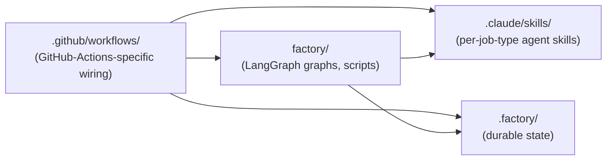

# Architecture Spine — light-factory

## Design Paradigm

The pipeline is a job-level finite state machine owned by GitHub Actions: jobs are states, and GitHub Actions Environment + required-reviewers protection rules are the guarded transitions at the two human-wait gates. All stages are jobs within **one workflow file, one triggered run** — never separate workflow files — connected by `needs:`, so GitHub's native job-output passing threads shared identifiers (starting with the story-slug) between stages without any stage re-deriving them independently. The judgment jobs (`analysis`, `implementation`, `review`) each run a LangGraph orchestration graph (intake/analysis; implementation; review/fix-loop) that lives and dies within that job's own runner process — graph state never needs to survive a job boundary. What does cross a job boundary is durable state only: the files under `.factory/`, committed to the run's branch (AD-10).

Namespace mapping:
- `.github/workflows/` — the job-level FSM and its gates (GitHub-Actions-specific wiring).
- `factory/` — the portable orchestration layer: LangGraph graphs and scripts, agnostic of any specific CI platform.
- `.claude/skills/` — per-job-type agent capabilities (analysis, implementation, review), invoked by `factory/`.
- `.factory/` — durable state that crosses job boundaries, read by both the human reviewer and the orchestration script.

## Invariants & Rules



Dependency arrows only point from GitHub-Actions-specific wiring inward. `factory/` and `.claude/skills/` must never reference `.github/workflows/`-specific constructs (job names, Environment names) — this is what keeps the orchestration layer portable to a future dedicated orchestrator.

### AD-1 — Blueprint/template repo shape

- **Binds:** all
- **Prevents:** factory logic becoming entangled with any one target repo's CI specifics, blocking a later migration to a dedicated cross-repo orchestrator
- **Rule:** light-factory ships as a template copied into each target project's own repo, not as a dedicated orchestrating repo. The orchestration graph, agent skill configs, and pipeline scripts (`factory/`, `.claude/skills/`) must stay isolated from GitHub-Actions-specific wiring (`.github/workflows/`) so they can migrate to a dedicated orchestrator later without a rewrite.

### AD-2 — Hybrid state machine: GitHub Actions owns gates, LangGraph owns in-job orchestration

- **Binds:** pipeline orchestration, all stages
- **Prevents:** building a custom long-poll/wake mechanism for multi-day human waits, or forcing in-job agent state to survive across separate ephemeral runner instances
- **Rule:** GitHub Actions Environment + required-reviewers protection rules own the two long human-wait gates (canonical Environment names: `plan-approval`, `evidence-approval`) as job boundaries within a single workflow run — GitHub pauses and resumes that same run natively, up to 30 days, with no extra infrastructure. LangGraph owns the in-job agent orchestration graph (clarification loop, bounded fix loop, agent routing) only within a single job's lifetime. A reviewer **reject** on either Environment is terminal for that run — native Environment protection has no mechanism to resume a rejected run into an earlier job. "Changes requested" therefore means the run ends without merging, and the human re-triggers the pipeline's first job as a new run (consistent with v1's manual-trigger-only model), not an automatic same-run loop-back. The PR AD-12 opened at intake for this run is closed at reject time, per AD-15 — by the trailing reject-cleanup job AD-16 defines, which is also how a reject is told apart from an ordinary job failure.

### AD-3 — No hosted orchestration server for v1

- **Binds:** orchestration technology choice
- **Prevents:** introducing a separately hosted stateful orchestration server that contradicts the blueprint/minimal-footprint PoC goal
- **Rule:** v1 must not depend on a hosted orchestration server (Camunda/Zeebe, Temporal). These are deferred as a possible future upgrade only if light-factory becomes a dedicated repo orchestrating many target projects at scale.

### AD-4 — Gate summaries as PR comments, detail in committed files

- **Binds:** the `plan-approval` gate, the `evidence-approval` gate
- **Prevents:** forcing the human reviewer to open full detail files just to make a go/no-go decision
- **Rule:** every stage ending in a human gate posts a concise human-readable summary as a PR comment, while the full detail stays in the committed `.factory/` state file for drill-down. The human decides from the summary and opens full detail only when warranted. Since AD-12 opens the PR during intake, both `plan-approval` and `evidence-approval` use the same PR-comment mechanism uniformly — there is no commit-comment special case.

### AD-5 — Defense-in-depth least-privilege enforcement

- **Binds:** all agent invocations
- **Prevents:** relying on a single permission layer that a misbehaving or prompt-injected agent could bypass
- **Rule:** least privilege is enforced at two independent layers, neither sufficient alone: (1) a Claude Code tool-allowlist per invocation — e.g. the review agent has no write/edit tool at all; the implementation agent's edit tools are scoped both to its isolated branch (git-ref boundary) **and** to the state-file paths AD-10 assigns to its own stage, explicitly excluding `plan.md`, `decisions.md`, and `review.md` (owned by other stages) even though those files live on the same branch; no invocation has merge/admin tools. (2) platform-level GitHub token/branch-protection scoping — each job's token permissions match only that stage's needs, and branch protection blocks direct push to main and requires PR + checks to merge, independent of what any agent attempts. The `analysis` job's token permissions include `contents: write` and `pull-requests: write` to run AD-12's branch/PR-open script — scoped to that script alone, never to the analysis agent's own tool-allowlist, which stays read-only. The `implementation` and `checks` jobs hold `contents: write` only (branch checkout, commit, push); `review` adds `pull-requests: write` for the `evidence-approval` summary comment; `merge` holds both for the squash-merge. The trailing reject-cleanup job (AD-16) holds `actions: read` (the run's review history), `pull-requests: write` (find and close the PR, with its comment), and `contents: read` (checkout) — no `contents: write`, so it can neither push nor delete a branch — and invokes no agent at all.

### AD-6 — Orchestration language: Python / LangGraph native SDK; scope is judgment work only

- **Binds:** orchestration layer (`factory/graph/`); the boundary between the graph and direct pipeline steps
- **Prevents:** splitting orchestration logic across languages or SDKs; wiring deterministic checks as LangGraph nodes or agent tool calls, which would silently move them from direct pipeline steps back into agent-delegated work
- **Rule:** the orchestration graph is implemented in Python using LangGraph's native SDK, and its scope is judgment work only — analysis, implementation, review, and the fix loop. Deterministic checks (build, test, lint, security) are implemented as direct pipeline steps in `.github/workflows/`, never as graph nodes or agent tool calls.
- **Addendum (2026-10-11, `epic-pipeline-hardening` ticket 1):** the commands those four steps run are not written in `run_checks.py`; they come from the repo's own `.github/post-implementation-checks.yml` (YAML, parsed with PyYAML), so one script checks whatever project the repo holds. The check names stay fixed (`build`, `test`, `lint`, `security`). Each check holds a list of commands, each a list of arguments with no shell; all of them run on every story, in order, with no path filtering, and the check stops at the first failure. A check with no command records `status: "skipped"`, never `"pass"` — in the light-factory repo that is `security`, permanently (user's call); a project that wants a real security check configures a command for it. A missing or malformed config is a `"fail"` naming the problem, never a silent skip. The config is read from `origin/main` (`git show`), not from the story branch's working tree, so a story cannot change the commands by editing the config (`run_checks.py` itself still runs from the story branch); only if that ref cannot be read does it fall back to the working tree, and each evidence file records which one was used as `config_source`. Runner toolchain setup (e.g. a JDK or Node) is not part of the config; it is a workflow step added with the project that needs it.
- **Addendum (2026-10-12, `epic-demo-app` ticket 7):** when a project's own checks need a runner toolchain the `ubuntu-latest` runner doesn't already provide (freight-tenders needs Java 25 and Node 26, neither implicit), that setup is still a workflow step, not folded into the config above as new logic — but which versions to install is itself config-driven, the same way the commands are. `.github/post-implementation-checks.yml` gains a second, optional top-level mapping, `toolchains:` (keys limited to `java`/`node` — only what this project needs; a project needing more extends the mapping and the reader together, not by inventing a parallel mechanism), read by a new `run_checks.py toolchains` subcommand via the same `origin/main`-with-working-tree-fallback path the four checks already use, printing `java=`/`node=` lines (empty string for an absent key) shaped for `>> "$GITHUB_OUTPUT"`, mirroring `state_io.py`'s `derive`. The `checks` job's workflow gains three steps before its check steps: run that subcommand into `$GITHUB_OUTPUT` (`id: toolchain`), then `actions/setup-java@v6` and `actions/setup-node@v7`, each `if:`-gated on that step's own output being non-empty — so a repo/config with no `toolchains:` entry runs exactly as before this addendum, with no setup step and no behavior change.
- **Addendum (2026-10-12, ticket 2):** the fixed check names gain a fifth, `static_analysis` — a category for bug-pattern static analysis, distinct from the style-only `lint` check, that the generic pipeline mechanism had no name for. It mirrors the other four exactly: a `run_static_analysis()` wrapper in `run_checks.py`, a 5th `checks` job step, and a 5th entry in the "fail job if any check failed" loop. In the light-factory repo it is left unconfigured — `static_analysis:` names the key in `.github/post-implementation-checks.yml` with no commands, so it records `status: "skipped"`, never `"pass"`, the same way `security` does today (user's call, 2026-10-12). Real commands for freight-tenders are deferred to a separate plan. **Follow-up (2026-10-12, ticket 2's freight-tenders plan):** that separate plan has now landed — `static_analysis:` holds real commands for freight-tenders, `mvn spotbugs:check` for the backend and a new dedicated ESLint bug-pattern script for the frontend, so it records `"pass"`/`"fail"` for freight-tenders rather than `"skipped"`.
- **Addendum (2026-10-13, backlog bug 5):** a check must not rely on an earlier check having run. The `checks-fix-loop` job re-runs only the failed check(s) on a fresh runner, so a dependency install that lived in `build`'s command list (`npm ci`) was missing from every re-check of `test`, `lint` or `static_analysis`, which then failed with return code 127 on correct code (runs 38377603346, 38387681388). Two things now hold for both jobs. (1) The toolchain setup above is one local composite action, `.github/actions/checks-toolchain`, used by the `checks` job and the `checks-fix-loop` job alike — neither carries setup steps of its own, and `factory/scripts/tests/test_workflow_checks_setup.py` fails if that changes. (2) `.github/post-implementation-checks.yml` gains a third, optional top-level key, `setup:` — a list of commands shaped like a check's, read the same `origin/main`-first way — holding what prepares the checkout for the checks (`npm ci` moved there from `build`). `run_checks.py setup` runs it as a `checks` job step before the five checks (`continue-on-error`, counted in the job's fail loop); `checks_fix_loop_graph.py` calls the same `run_checks.run_setup()` as a plain function before every re-check, after the agent's edits, since a fix may change what there is to install — and so does the `review` job's `fix_loop_graph.py` before its own `build`/`test` recheck (AD-11), which runs on a fresh runner too and had relied on `build` installing the dependencies. Setup is not a sixth check, but its result is recorded the way a check's is, as `evidence/checks/setup.json`, so a setup that failed in the `checks` job can be named by the job that follows. A config without `setup:` prepares nothing and behaves as before. Not covered here: the `review` job still installs Node 22 itself and does not use the shared toolchain action (tracked in `deferred-work.md`).

### AD-7 — External dependencies scoped to GitHub + Claude Code only

- **Binds:** all
- **Prevents:** scope creep into ticket-system or chat integrations before v1 proves the core loop
- **Rule:** v1's only external dependencies are GitHub (repo, Actions, Environments) and Anthropic/Claude Code. No ticket system or chat integration is in scope.

### AD-8 — Per-story, per-run state directory layout, slug derivation, and propagation

- **Binds:** state persistence across all stages
- **Prevents:** concurrent stories colliding on shared state files; two jobs independently computing different story-slugs and reading/writing different directories; a re-triggered run of the same story colliding with its terminal predecessor's state (see AD-15)
- **Rule:** state lives at `.factory/<story-slug>/<run-id>/` per story per run (AD-15 defines `run-id`), holding `plan.md`, `decisions.md`, `review.md`, and `evidence/{checks/, review/}` (split by writer: `checks/` for deterministic pipeline-step output — build/test/lint/security; `review/` for the independent review agent's findings/metrics). `story-slug` is derived exactly once, in the workflow's first job, from the triggering story file's name (`stories/<project>/<story-slug>.md`, `<project>` being `light-factory` or `freight-tenders`, kebab-case required on the input file; the slug is the file name alone and carries no project — AD-15 keeps it unique). That job exposes it as a job output; every downstream job (connected via `needs:`, per AD-2) consumes that output — no job independently re-derives the slug from any other source.

### AD-9 — Claude Code auth via subscription OAuth token

- **Binds:** all Claude Code invocations
- **Prevents:** metered pay-per-token billing exposure from agent calls, including retries within the bounded fix loop
- **Rule:** authenticate with `CLAUDE_CODE_OAUTH_TOKEN` (subscription-based: Pro/Max/Team/Enterprise), not `ANTHROPIC_API_KEY`. The token must be generated via `claude setup-token` — the long-lived, CI-intended path. The quick `/install-github-app` setup flow's OAuth token is explicitly out: it is reported to expire in hours-to-a-day with no auto-refresh, which would silently break a pipeline mid-gate-wait and undermine this AD's own reliability intent. Billing draws from the subscription's shared usage budget; the bounded-fix-loop cost guardrail (AD-11) applies against that same budget.

### AD-10 — Append-only per-stage state file ownership

- **Binds:** all pipeline stage state files under `.factory/<story-slug>/`
- **Prevents:** one stage overwriting or corrupting another stage's record, which would break the audit trail; divergence between human-readable and machine-readable state
- **Rule:** each stage writes only its own state file (e.g. the analysis stage writes `plan.md` and `decisions.md`; the review stage writes `review.md`) and never mutates a prior stage's file. Every state file's YAML frontmatter uses exactly these shared field names — no stage invents its own naming for the same concept: `schema_version` (int), `story_slug` (string, matches the directory name from AD-8), `stage` (`analysis` \| `implementation` \| `review`), `status` (stage-specific enum below), `updated` (ISO 8601). Canonical `status` values: `plan.md`/`decisions.md` — `drafted`, `awaiting-clarification`, `clarification-cap-reached`, `ready-for-review`; `review.md` — `in-review`, `findings-open`, `fix-in-progress`, `resolved`, `unresolved-after-cap`. No other status strings are valid. Both the human reviewer and the orchestration script read this frontmatter as the single source of truth. **Addendum 2026-10-11** (entry 8 of `epic-pipeline-open-issues`, which moved the mechanical checks and the review into their own jobs): state crosses job boundaries only through git. The `checks` and `review` jobs each start by checking out the run's branch (`checkout_branch.py`) and end by committing and pushing whatever they wrote under `.factory/` (`commit_push_implementation.py --label Checks` / `--label Review`) — unconditionally, so `evidence/checks/` and `review.md`/`evidence/review/` reach the next job even when no fix cycle committed anything. There is no second persistence mechanism (e.g. workflow artifacts). **Addendum 2026-10-13** (gap found reviewing run 38375222879): the `checks` job's five check steps (`build`/`test`/`lint`/`security`/`static_analysis`) each carry `continue-on-error: true` so all five run and commit their evidence regardless of an earlier failure, then a final `Fail job if any check failed` step re-reads each step's recorded `outcome` and `exit 1`s the job if any is `failure` — this is the signal `checks-fix-loop`'s `if: needs.checks.result == 'failure'` watches for; there is no other channel carrying "a check failed" between the two jobs today. This leaves a known gap, not yet fixed: GitHub Actions aggregates a run's overall conclusion from its worst job conclusion, so a run where `checks-fix-loop` fully recovers and the story still merges nonetheless shows red in the Actions UI, indistinguishable at a glance from a run that stayed broken. Tracked as `_bmad-output/backlog/bug-checks-job-false-red-on-recovered-fix-loop.md` (id 4): the planned fix has `checks` always exit 0 and instead report a job output (mirroring `analysis`'s existing `status` output) for `checks-fix-loop` and `review` to read, so only a fix loop that exhausts AD-11's cap — never one that recovers — leaves a job, and the run, red.
- **Addendum (2026-10-13, backlog bug 5):** `checks.md` is the state file of stage `checks` (`state_io.py`'s `STATUS_BY_STAGE`), a stage that spans two jobs. The `checks-fix-loop` job writes it (`checks_fix_loop_graph.py`): `findings-open` per fix cycle, then one final status, with the `fix_cycle` counter stamped by that code alone. The `checks` job writes it in exactly one case, through `run_checks.py reconcile`: the file already exists with a status other than `resolved`, the current attempt's setup did not fail, and all five of its checks passed or were skipped — it is then reset to `resolved` with no failing checks listed and its `fix_cycle` kept. This is what corrects the file after a re-run of a run's failed jobs, when the fix loop — the only other writer — does not run again. The `checks` job never creates the file and never touches it while a check fails. Canonical `status` values for `checks.md`: `checking`, `findings-open`, `fix-in-progress`, `resolved`, `unresolved-after-cap`, `tooling-failure`. `tooling-failure` means a check's command, or a `setup:` command, could not be run at all (a shell's return code 126 or 127, or the command could not be spawned; any failure for a setup command): the loop stops without engaging the implementation agent for it, the file names the check and command, and the job fails with its own exit code (6), distinct from `unresolved-after-cap`'s (1). It applies to the evidence the `checks` job wrote — its checks' and its setup's — as well as to a re-check: a setup that failed in the `checks` job stops the loop before any fix cycle, whatever the checks after it reported. Checks that still hold a real finding stay listed in `checks.md` beside the tooling failure. A check with no evidence at all is still handled by a fix cycle, as before.

### AD-11 — Bounded fix loop, hard cap at 2 cycles

- **Binds:** the `review` job's review → fix → re-check loop
- **Prevents:** open-ended agent spend on a story the automated review keeps rejecting; silently burning AI budget instead of surfacing the problem to a human
- **Rule:** `review.md`'s frontmatter tracks a fix-cycle counter, incremented only by the orchestration graph's own loop-control node — never by the review agent's or the fix agent's output. Agents report findings and fixes; only the graph mutates the counter. The graph enforces a hard cap of 2 fix cycles: on the second unresolved review, it must not loop again — it routes directly to the `evidence-approval` gate with `status: unresolved-after-cap`, carrying the outstanding findings for the human to triage, rather than continuing to spend agent turns. Each cycle re-runs only the checks relevant to the finding(s) being fixed, not the full check suite.

### AD-12 — PR opened by a deterministic pipeline step, once intake decides to proceed

- **Binds:** the `analysis` job, post-CAP-1 sequencing; branch reuse by the `implementation`, `checks` and `review` jobs; ties to AD-4, AD-5, AD-8, and AD-13
- **Prevents:** ambiguity about when/how the PR backing the rest of the run comes into existence; an analysis or implementation agent holding an unscoped git-push/PR-create capability AD-5's tool-allowlist model never named; a dangling open PR surviving a below-cap clarification halt or a gate reject with no closing action (see AD-2, AD-13, AD-15)
- **Rule:** once the `analysis` job's CAP-1 intake judgment decides to proceed (not on a halt), a deterministic pipeline script — not the agent — creates the isolated branch named from AD-8's story-slug and AD-15's run-id (`light-factory/<story-slug>/<run-id>`), commits the analysis stage's own first write of `plan.md`/`decisions.md` as the branch's first real commit (no placeholder commit needed — this is genuine content, not a GitHub-API workaround), and opens the PR against the target branch. This PR is the single artifact for the rest of the run: `plan.md`/`decisions.md` updates across clarification rounds (AD-13), the `plan-approval` gate summary (AD-4), all automated-check output, review findings, and fix-loop commits, and the `evidence-approval` gate summary all land on it. The `implementation`, `checks` and `review` jobs reuse this same branch — each checks it out via the propagated branch name (AD-8/AD-15 outputs), none creates a new one. Because this is a script step under AD-5's per-job token scoping (not the agent's own tool-allowlist), neither the analysis agent nor the implementation agent ever receives a branch-create or PR-create tool. A run that halts at CAP-1 (incomplete/out-of-scope) never reaches this script — no branch or PR exists for it. The same script closes any prior open PR for this story-slug it supersedes (AD-15) — branches and state directories are never deleted, only the superseded PR closes.

### AD-13 — Clarification: bounded rounds via re-trigger, no live mid-job wait (cap 2, counted from the PR chain)

- **Binds:** the `analysis` job's LangGraph graph (intake, analysis)
- **Prevents:** ambiguity about what happens when analysis can't fully resolve the story alone — without this, intake would either guess (undermining CAP-1/CAP-2) or silently stall; unbounded repetition of the same halt-and-re-trigger cycle with no signal that the story itself, not just a missing answer, may be the problem
- **Rule:** The `analysis` job makes one analysis invocation per run. If it returns any `open_questions`, the graph halts intake for that run — writes `plan.md`/`decisions.md` with `status: awaiting-clarification` (below cap) or `status: clarification-cap-reached` (at cap, AD-10's enum, new value), tags the PR AD-12 opened at intake with a `clarification-round` label so this round counts toward the cap, posts the open question(s) (or the cap-reached notice) as a comment on it, and — below the cap only — closes it per AD-15; at the cap the PR is left open for the developer to decide how to proceed (this path ends the run without reaching a gate, so AD-4's Rule doesn't itself cover the comment step — the convention is shared, the authority is this AD). The run ends without a gate mechanically: the `analysis` job exposes its status as a job output, and the `implementation` job — the one `plan-approval` guards — runs only when that status is `ready-for-review`, so on a halt it and every job after it are skipped and no review is requested (added by `epic-pipeline-hardening` ticket 2, 2026-10-11). A failure to write that status output fails the `analysis` job with its own exit code (5), so the gate stays closed. Before the state files are written, a deterministic step (never the agent) counts this story-slug's prior PRs in **any state** (open or closed) (same branch-name prefix `light-factory/<story-slug>/*` AD-15 uses to find the currently-open PR, but querying all states here — a distinct query AD-15 itself never performs, since an at-cap PR is deliberately left open yet must still count toward a later re-trigger's total, or the cap would silently reset) carrying the `clarification-round` label — a completed clarification round only (closed below cap, left open at cap), distinct from a reject-closed or ordinary-supersession-closed PR. If that prior count is already at or above the hard cap of 2 (matching AD-11's), this round's status and comment are `clarification-cap-reached` regardless of which attempt number it technically is: the developer is told the budget is spent and the story likely needs rescoping or splitting, not another answer attempt — the run still ends without a gate, same as any halt. This keeps the capped state stable on a 3rd or later re-trigger, rather than leaving that case undefined. Below the cap, behavior is unchanged from today: the developer answers by editing the story file itself (the only input `run_analysis` ever reads — this AD now names that explicitly, since nothing else carries an answer across a re-trigger) and re-triggers the pipeline as a new run, consistent with AD-2's reject-is-terminal/re-trigger pattern and v1's manual-trigger-only model. No live mid-job wait is introduced — AD-2's two-gate model (`plan-approval`, `evidence-approval`) is unchanged by this AD. **Decided 2026-10-10** (see `change-clarification-loop-bounded-rounds/change-clarification-loop-bounded-rounds.md`); this supersedes the v1 single-pass-halt simplification of 2026-10-02.

### AD-14 — Merge is a deterministic pipeline step, never an agent action

- **Binds:** the `merge` job
- **Prevents:** the `merge` job existing with no Rule behind it at all — AD-5 already rules out an agent performing the merge, but nothing previously said what does
- **Rule:** the `merge` job executes the merge as a direct pipeline step, triggered automatically on `evidence-approval`'s approval — consistent with AD-5's "no agent invocation ever holds merge/admin tools" and the v1 goal of a green, trusted pipeline that completes without a manual UI click. Merge strategy (squash/merge-commit/rebase), source-branch deletion, and merge-conflict handling are not decided here — see Deferred.

### AD-15 — Run-level isolation on re-trigger: concurrency-guarded, versioned by run-id, superseded PRs linked and closed

- **Binds:** AD-8's state-directory layout, AD-12's branch/PR naming, the workflow's own `concurrency:` declaration; the re-trigger path from AD-2's reject-is-terminal pattern and AD-13's cap-out
- **Prevents:** a re-triggered run colliding with its terminal predecessor's branch/PR/state-directory (all previously keyed only by story-slug, which doesn't distinguish attempts); a prior attempt's analysis/review/evidence being silently overwritten or orphaned; two runs for the same story racing concurrently, where a reviewer could approve a gate on a run a later re-trigger has already superseded — a "zombie" approval reaching the `merge` job against an already-closed PR
- **Rule:** the workflow declares `concurrency: {group: light-factory-<story_file input>, cancel-in-progress: true}` — keyed on the dispatch's raw `story_file` input, not the story-slug, because a workflow-level key is evaluated before any job runs and cannot read the derived slug. The guard therefore holds per input path, not per slug: `derive_story_slug` resolves the path and requires it to be exactly `stories/<project>/<name>.md` relative to the repository root, `<project>` being `light-factory` or `freight-tenders`, which rules out `stories/foo.md`, `other/foo.md`, `docs/stories/light-factory/foo.md`, `stories/billing/foo.md`, `stories/light-factory/sub/foo.md` and paths outside the repo. The slug is the file name alone, so it also refuses a file name that exists in both project folders at dispatch time — two such files would otherwise share one state directory, branch prefix and PR chain. Only different spellings of the one accepted file (`stories/light-factory/foo.md`, `./stories/light-factory/foo.md`, `stories//light-factory/foo.md`, an absolute path) still derive one slug, each in its own concurrency group because the group is taken from the raw input before any code runs. **Changed 2026-10-12** (backlog story 3, `story-group-story-files-by-project`): this reverses the "no sub-folders" rule of `epic-pipeline-hardening` ticket 3 (2026-10-11), which accepted only `stories/<name>.md`; story files are now grouped by the project they change, and the same-name refusal replaces what the flat folder guaranteed by itself. Within one input path — a second manual trigger for a `story_file` that still has a run in flight, including one paused at a gate, cancels that run outright rather than racing it; a re-trigger is always treated as explicit intent to supersede, never queued behind a pending gate. Every run also computes a `run-id` (`run-<github.run_id>` — GitHub's own globally-unique run identifier; zero extra bookkeeping) in the same first job that derives the story-slug (AD-8), threaded the same way via `needs:` outputs. AD-8's state directory and AD-12's branch/PR both nest under it: `.factory/<story-slug>/<run-id>/` and branch `light-factory/<story-slug>/<run-id>`. When AD-12's pipeline script opens a new run's PR, it searches for any other open PR for the same story-slug (by branch-name prefix `light-factory/<story-slug>/`) — this also catches a predecessor the concurrency guard cancelled before it could close its own superseded PR, so cascading cancellations resolve without special-casing — closes each with a comment linking to the new PR ("superseded by #N"), and the new PR's own opening comment links back ("retry of #M"). Superseded branches and state directories are left in place, not deleted — only the PR closes — consistent with the audit-trail-over-cleanup posture AD-10 and AD-12 already set. AD-2's reject at either gate (`plan-approval` or `evidence-approval`, detected and closed per AD-16) and AD-13's below-cap clarification halt each close their own run's PR at that moment too — with a comment stating why — not only when a later retrigger supersedes it. AD-13's own counting mechanism (how many prior rounds a story-slug has spent) is a separate query over PRs in **any state** (open or closed) by the same branch-name prefix, filtered to the `clarification-round` label — distinct from this Rule's open-PR search, which only ever finds the single currently-open PR to supersede. An open PR therefore almost always means "still awaiting a decision, never already resolved one way or the other" — except the one deliberate carve-out AD-13 creates: an at-cap PR stays open (so the developer can still act on it) but is itself a resolved, terminal state for that run, not an in-flight decision. There is no separate "current run" pointer file: the concurrency guard keeps at most one run in flight, and supersession-closing keeps at most one PR open per story-slug, so "which run is current" is always answered directly by GitHub — the one open PR matching the branch prefix (or, in the brief pre-PR window of the `analysis` job, whichever run is actually in flight).

### AD-16 — Reject detection from the run's review history, PR closed by a trailing job

- **Binds:** the workflow's job graph (a trailing job after `merge`); AD-2's reject-is-terminal rule; AD-15's "a reject closes its own run's PR at that moment"; AD-5's per-job token scopes
- **Prevents:** a rejected run's PR staying open until someone closes it by hand; treating an ordinary job failure (a crash, a failing check, a merge conflict) as a reject and closing a PR that is still awaiting a fix — a rejected gated job runs no step and its `needs.<job>.result` reads `failure`, exactly like a crash, so the result alone cannot tell the two apart and the gated job cannot report its own reject
- **Rule:** the workflow ends with a reject-cleanup job that `needs:` `analysis`, `implementation` and `merge` and runs only when the run was not cancelled and one of the two gated jobs — `implementation` or `merge` — has result `failure`. It never runs on a successful run, on a concurrency-cancelled one (AD-15's supersession closes that PR), or after a `checks` or `review` failure, which leaves `merge` `skipped` rather than `failure`. It runs one deterministic script (`close_rejected_pr.py`), never an agent (AD-5). A reject is decided only from this run's own review history — `GET /repos/{owner}/{repo}/actions/runs/{run_id}/approvals`, an entry with `state: "rejected"` naming the Environment of the gate guarding the job that failed (`plan-approval` for `implementation`, `evidence-approval` for `merge`) — never inferred from `needs.<job>.result` alone; a `rejected` entry for the other gate does not count. On a reject the script closes this run's own PR (branch `light-factory/<story-slug>/<run-id>`, both threaded via `needs:` outputs, AD-8/AD-15) with a comment naming the gate, the rejecting reviewer, their review comment when they left one, and that a re-trigger starts a new run. Only the PR closes: the branch and state directory stay (AD-10/AD-12/AD-15), no label is applied (`clarification-round` is AD-13's alone), no state file is written, and nothing is re-triggered. When the gate was not rejected, or the PR is already closed, the step succeeds without touching anything; only a failing or malformed API/`gh` call fails it. A same-run-id "re-run failed jobs" keeps earlier review-history entries, so a later attempt can still see an old `rejected` entry — harmless, since the first attempt already closed the PR and there is nothing left to close; no attempt-number filtering is needed.

## Consistency Conventions

| Concern | Convention |
| --- | --- |
| Naming (state files/directories) | `.factory/<story-slug>/<run-id>/` per story per run, containing `plan.md`, `decisions.md`, `review.md`, `evidence/checks/`, `evidence/review/`. No separate "current run" pointer file — the concurrency guard + PR supersession (AD-15) keep at most one run in flight and one PR open per story-slug, so that single open PR is the answer |
| Naming (gates/environments) | Canonical identifiers are exactly `plan-approval` and `evidence-approval` — the only strings used in workflow YAML, scripts, and job names. "Plan confirmation" / "evidence review" are human-prose synonyms only, never literal identifiers in code |
| Naming (run identity) | `run-id` = `run-<github.run_id>`, computed once alongside `story-slug` in the first job, threaded via `needs:` outputs — never independently re-derived or counted (AD-15) |
| State & cross-cutting (concurrency) | Workflow-level `concurrency: {group: light-factory-<story_file input>, cancel-in-progress: true}`, keyed on the input path, not the story-slug — a re-trigger with the same `story_file` always cancels and supersedes any run still in flight for it, never races or queues behind it (AD-15) |
| Data & formats (state-file frontmatter) | Shared field names across every state file: `schema_version`, `story_slug`, `stage`, `status`, `updated` — see AD-10 for the canonical `status` enum per file |
| State & cross-cutting (mutation, permissions) | Each stage owns and writes only its own state file (append-only across stages, AD-10); agent permissions are enforced both via Claude Code tool-allowlists scoped to specific state-file paths (not just the branch) and via GitHub token/branch-protection scoping — never one alone (AD-5) |
| State & cross-cutting (identifiers) | `story-slug` is computed once, in the workflow's first job, and threaded to every other job via `needs:` outputs — never independently re-derived (AD-8) |
| State & cross-cutting (bounded loops) | Fix loop (`review` job): hard-capped at 2 cycles, counted by a counter owned solely by the orchestration graph's loop-control node, never by the agent; `status: unresolved-after-cap` on cap-out (AD-11). Clarification (`analysis` job): hard-capped at 2 rounds, counted from AD-15's existing PR-chain `clarification-round` labels (no new state, no live mid-job wait) — `status: awaiting-clarification` below the cap, `status: clarification-cap-reached` at it (AD-13) |
| Naming (PR/comment target) | The PR exists from the moment the `analysis` job's CAP-1 judgment decides to proceed (AD-12) — both `plan-approval` and `evidence-approval` summaries post as PR comments on it (AD-4). A below-cap clarification halt or a reject at either gate (`plan-approval` or `evidence-approval`, AD-16) closes that PR with a comment (AD-15); an at-cap clarification PR gets its comment but stays open (AD-13); a re-trigger's new PR closes and links to any PR it supersedes (AD-15) |
| Naming (clarification rounds) | Each PR that ends a run on an unresolved open question — closed below the cap, left open at it — is tagged `clarification-round` — AD-13 counts these (by AD-15's branch prefix, across all PR states) to enforce the 2-round cap; no separate counter file |

## Stack

| Name | Version |
| --- | --- |
| LangGraph (Python) | 1.2.12 |
| Python | >=3.13 (3.14 is current stable and well-supported through 2030; 3.13 exits active support 2026-10-01. 3.15.0 also ships 2026-10-01 — re-verify at implementation time, but 3.14 is a safe target either way) |
| Claude Code CLI `@anthropic-ai/claude-code` (auth: CLAUDE_CODE_OAUTH_TOKEN) | >=2.1.x, track `@latest` (ships near-daily; requires Node 22+) |
| Node.js | >=22 (required by Claude Code CLI since v2.1.198) |
| GitHub Actions (Environments + required-reviewers protection rules) | — (hosted platform) |

## Structural Seed

```mermaid
stateDiagram-v2
    [*] --> AnalysisJob

    note left of AnalysisJob
        All jobs below run in ONE workflow
        file, ONE triggered run, chained by
        needs: (not separate workflow files).
        story-slug AND run-id are computed
        once here and threaded to every later
        job as needs: outputs (AD-8, AD-15).
        Workflow-level concurrency guard keyed
        on story-slug cancels any run already
        in flight for this story, including one
        paused at a gate below (AD-15) -- a
        re-trigger always supersedes, never races.
    end note

    state "analysis job (GitHub Actions)" as AnalysisJob {
        state "LangGraph: intake -> analysis (CAP-1/CAP-2), one pass per run, bounded via re-trigger (AD-13)" as LG1a
        state "Pipeline script: create branch, commit plan.md/decisions.md, open PR\n(AD-12, deterministic -- not an agent action)" as OpenPR1
        [*] --> LG1a
        LG1a --> Halted: incomplete/out-of-scope, no branch/PR opened
        LG1a --> OpenPR1: proceed (CAP-1 passed)
        OpenPR1 --> WritePlan: resolved, writes plan.md, decisions.md (status: ready-for-review)
        OpenPR1 --> NeedsClarification: open_questions AND prior rounds < cap, writes status: awaiting-clarification, closes PR tagged clarification-round (AD-13/AD-15)
        OpenPR1 --> ClarificationCapped: open_questions AND prior rounds >= cap (2), writes status: clarification-cap-reached, tags PR clarification-round, leaves it open (AD-13)
        WritePlan --> PostSummary1: PR comment summary (AD-4)
        NeedsClarification --> PostSummaryCapA: PR comment, open question(s) surfaced, PR closed
        ClarificationCapped --> PostSummaryCapB: PR comment, cap-reached notice, PR left open
        PostSummary1 --> [*]
        PostSummaryCapA --> [*]: run ends here, no GateA (see RunEndsClarify below)
        PostSummaryCapB --> [*]: run ends here, no GateA -- story likely needs rescoping, not another answer
        Halted --> [*]: run ends here, no branch/PR ever existed
    }

    AnalysisJob --> GateA: normal path, Environment pause (same run)
    AnalysisJob --> RunEndsClarify: open question, prior rounds < cap (AD-13)
    AnalysisJob --> RunEndsClarifyCap: open question, prior rounds >= cap (2) (AD-13)

    state "Run ends, no plan-approval attempt.\nHuman answers by editing the story file,\nre-triggers the pipeline as a NEW run (new run-id,\nAD-15) -- up to 2 consecutive rounds." as RunEndsClarify
    RunEndsClarify --> [*]

    state "Run ends, clarification cap (2) reached.\nStory likely needs rescoping/splitting,\nnot another answer attempt (AD-13)." as RunEndsClarifyCap
    RunEndsClarifyCap --> [*]

    state "Gate: plan-approval (GitHub Environment, required reviewers)" as GateA
    GateA --> ImplementationJob: approve
    GateA --> RunEndsA: reject (terminal -- see AD-2)

    state "Run ends, no merge. This run's PR\nis closed at reject (AD-16).\nHuman re-triggers the pipeline as a NEW\nrun (new run-id, new PR, AD-15)." as RunEndsA
    RunEndsA --> [*]

    state "implementation job (GitHub Actions)" as ImplementationJob {
        state "Pipeline script: checkout existing branch\n(opened by the analysis job, AD-12 -- not created here)" as CheckoutBranch
        state "LangGraph: implementation agent" as LG2a
        state "Pipeline script: commit + push the agent's edits" as CommitImpl
        [*] --> CheckoutBranch
        CheckoutBranch --> LG2a: implementation agent invoked
        LG2a --> CommitImpl
        CommitImpl --> [*]
    }

    ImplementationJob --> ChecksJob: needs: (no gate)

    state "checks job (GitHub Actions)" as ChecksJob {
        state "Pipeline script: checkout the same branch" as CheckoutChecks
        state "direct pipeline steps: build/test/lint/security (AD-6)" as RunChecks
        state "Pipeline script: commit checks evidence (AD-10)" as CommitChecks
        [*] --> CheckoutChecks
        CheckoutChecks --> RunChecks
        RunChecks --> CommitChecks
        CommitChecks --> [*]
    }

    ChecksJob --> ReviewJob: needs: (no gate)

    state "review job (GitHub Actions)" as ReviewJob {
        state "Pipeline script: checkout the same branch" as CheckoutReview
        state "LangGraph: independent review agent" as LG2b
        state "LangGraph: bounded fix loop (cap 2 cycles, AD-11)" as FixLoop
        state "Pipeline script: commit review evidence (AD-10)" as CommitReview
        [*] --> CheckoutReview
        CheckoutReview --> LG2b
        LG2b --> FixLoop: findings (graph increments counter)
        FixLoop --> LG2b: fix committed, build/test re-run
        LG2b --> WriteReview: pass, or cap hit (unresolved-after-cap)
        WriteReview --> CommitReview
        CommitReview --> PostSummary2: PR comment summary (AD-4)
        PostSummary2 --> [*]
    }

    ReviewJob --> GateB: Environment pause (same run)

    state "Gate: evidence-approval (GitHub Environment, required reviewers)" as GateB
    GateB --> MergeJob: approve
    GateB --> RunEndsB: reject (terminal -- see AD-2)

    state "Run ends, no merge. This run's PR\nis closed at reject (AD-16).\nHuman re-triggers pipeline as a NEW\nrun (new run-id, new PR, AD-15)." as RunEndsB
    RunEndsB --> [*]

    state "merge job (GitHub Actions)\ndeterministic pipeline step, never an agent (AD-14)" as MergeJob
    MergeJob --> [*]
```



```text
<target-repo>/
  .github/
    post-implementation-checks.yml      # the repo's own commands for the build/test/lint/security checks, read from origin/main (AD-6 addendum)
    workflows/
      light-factory.yml                 # ONE workflow, ONE run: jobs analysis -> [plan-approval] -> implementation ->
                                         # checks -> review -> [evidence-approval] -> merge, plus a trailing close-rejected-pr,
                                         # chained via needs:; story-slug computed in the analysis job, threaded as a needs: output
  factory/
    graph/
      analysis_graph.py                 # LangGraph: intake, analysis, bounded clarification rounds via re-trigger (AD-13)
      implementation_graph.py           # LangGraph: implementation agent invocation, scoped Edit/Write (AD-5)
      review_graph.py                   # LangGraph: independent read-only review agent (CAP-6, AD-5)
      fix_loop_graph.py                 # bounded fix loop: review -> fix -> recheck, counter owned here, hard cap 2 cycles (AD-11)
    scripts/
      checkout_branch.py                # deterministic: checks out the branch the analysis job already opened, never creates one -- run by implementation, checks and review (AD-12)
      commit_push_implementation.py     # deterministic: commits/pushes the implementation agent's edits and each later job's evidence (--label), no-op if none (AD-10)
      run_checks.py                     # deterministic: runs the commands configured per check; a check with none is skipped (AD-6, CAP-5)
      open_implementation_pr.py         # deterministic: creates isolated branch, commits plan.md/decisions.md as the real first commit, opens PR, closes/links any superseded PR -- invoked from the analysis job once CAP-1 passes; later jobs check out the same branch rather than creating one (AD-12, AD-15)
      post_summary.py                   # posts a stage-gate summary as a PR comment (AD-4) -- shared by both gates; reused directly by analysis_graph.py (plan-approval) and by post_evidence_summary.py (evidence-approval)
      post_evidence_summary.py          # evidence-approval's own evidence-gathering + rendering, posts via post_summary.py (AD-4, CAP-8)
      merge_story.py                    # deterministic: squash-merges and deletes the branch on evidence-approval, never an agent (AD-5, AD-14, CAP-9)
      close_rejected_pr.py              # deterministic: trailing job's reject cleanup -- reads the run's review history, closes this run's PR with a comment only on a real gate reject, never an agent (AD-2, AD-5, AD-16)
      state_io.py                       # reads/writes .factory/ state files; owns the shared frontmatter schema (AD-10)
  .claude/
    skills/
      light-factory-analysis/           # analysis-agent skill (design)
      light-factory-implementation/     # implementation-agent skill (coding)
      light-factory-review/             # review-agent skill (read-only)
  .factory/
    <story-slug>/
      <run-id>/                         # one subtree per run/attempt of this story (AD-15); superseded runs are left in place, not deleted.
                                         # no pointer file for "current run" -- the concurrency guard + PR supersession (AD-15)
                                         # keep at most one run in flight and one PR open per story-slug, so GitHub itself answers it
        plan.md                         # written by analysis stage only
        decisions.md                    # written by analysis stage only
        review.md                       # written by review stage only
        evidence/
          checks/                       # written by direct pipeline-step checks (build/test/lint/security)
          review/                       # written by the independent review agent only
```

## Capability → Architecture Map

| Capability | Lives in | Governed by |
| --- | --- | --- |
| CAP-1 Intake validation | `analysis` job, analysis-stage skill prompt | Not architecturally decided — left to `.claude/skills/light-factory-analysis/` content, not an AD |
| CAP-2 Agent analysis and plan proposal | `analysis` job (`analysis_graph.py`) | AD-2, AD-10, AD-13 |
| CAP-3 Plan-approval human gate | `plan-approval` GitHub Environment | AD-2, AD-4 |
| CAP-4 Scoped implementation | `analysis` job opens the isolated branch + PR once CAP-1 proceeds; `implementation` job reuses it for code | AD-5, AD-8, AD-12, AD-15 |
| CAP-5 Automated mechanical checks | `checks` job, `.github/workflows/` steps; commands from `.github/post-implementation-checks.yml` as it is on `origin/main` | AD-6 |
| CAP-6 Independent agent review | `review` job (`review_graph.py`) | AD-5, AD-8, AD-10 |
| CAP-7 Bounded fix loop | `review` job (`fix_loop_graph.py`) | AD-11 |
| CAP-8 Evidence-approval human gate | `evidence-approval` GitHub Environment | AD-2, AD-4 |
| CAP-9 Approval and merge | `merge` job (`merge_story.py`) | AD-14 |

## Deferred

- **Staging deployment and controlled production rollout automation** — v1 scope ends at merge (brief).
- **Swappable AI providers/models** — Claude Code is the only runtime for v1; multi-provider support is a desirable future property, not a v1 requirement (brief).
- **Alternative trigger mechanisms** (issue labels, PR-linked stories, watched intake folders, ticket-system webhooks) — v1 is manually triggered only (brief).
- **Multi-role approval workflows** (separate approver from requester) — a single role holds all three gates in v1 (brief).
- **Zero-manual-code-edits enforcement** — a near-term goal after a few iterations beyond v1, not the MVP bar (brief).
- **Ticket-system and chat integrations** — out of scope as external dependencies for v1; only GitHub and Claude Code are wired in (AD-7).
- **Migration to a dedicated orchestrating repo** — v1 ships as a per-project blueprint/template; factory logic is kept isolated from GitHub-Actions-specific wiring specifically so this migration is possible later without a rewrite (AD-1).
- **Temporal/Camunda as a future orchestration upgrade** — deferred as the natural evolution if/when light-factory becomes a dedicated repo orchestrating many target projects at scale (AD-3).
- **Non-gate failure/retry semantics** (a LangGraph node throwing, a runner crash, a transient GitHub API failure — distinct from a human-gate reject) and **runner type** (GitHub-hosted vs. self-hosted) — undecided; sufficient as an explicit v1 cut for a PoC, revisit if real runs surface reliability gaps.
- **Merge mechanics beyond the actor** — strategy (squash/merge-commit/rebase), source-branch deletion, and merge-conflict handling for the `merge` job (AD-14 fixes only that the merge is a deterministic step, not an agent).
